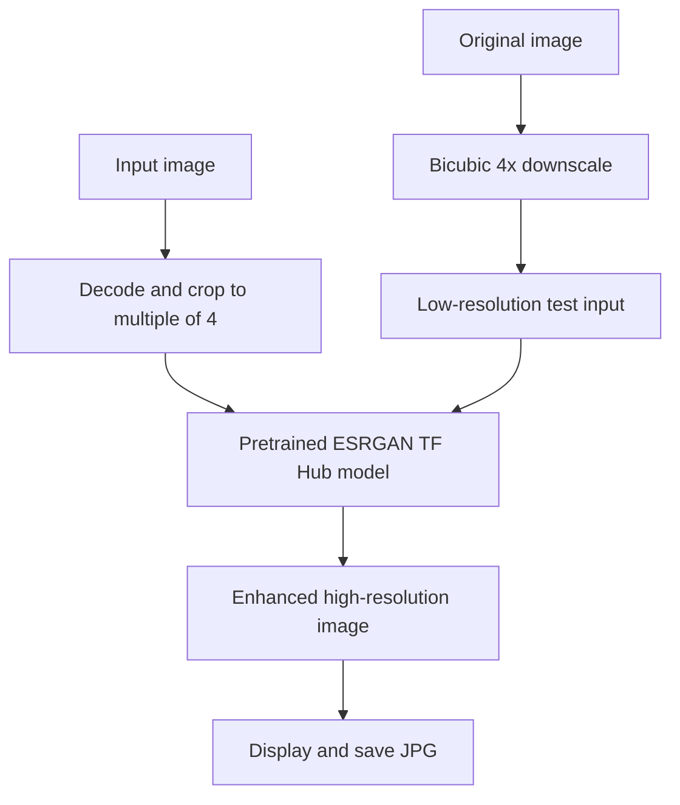

# Single-Image Super-Resolution with ESRGAN (TensorFlow Hub)

**Unindexed DeepLearning directory — project ID requires inventory reconciliation**  
**Path:** `DeepLearning/- 34 — Super-Resolution for Image Reconstruction using GANs`

## Objective
Upscale a low-resolution image using a pretrained ESRGAN TensorFlow Hub model. Despite the folder title mentioning GANs, the notebook loads a published pretrained model rather than implementing or training a GAN from scratch.

## Pipeline
- Download/load an example image.
- Decode and crop dimensions to multiples of four.
- Convert to float32 and add a batch dimension.
- Load `https://tfhub.dev/captain-pool/esrgan-tf2/1`.
- Run super-resolution inference, measure model-call duration, display and save the generated image.
- Includes a helper that creates a 4× downscaled low-resolution sample using bicubic interpolation.

## Architecture

## Run
Notebook: `SuperResolution.ipynb`. Install TensorFlow, TensorFlow Hub, Pillow, NumPy and Matplotlib. Internet access is required for the sample image and model download. Replace the example image URL with a trusted local image path for reproducible use.

## Limitations
The notebook uses external image URLs (one is a long Bing redirect URL) and depends on an external TensorFlow Hub model. Output quality and inference time depend on input dimensions and runtime hardware. No PSNR/SSIM benchmark or paired ground-truth comparison is provided. The model is a pretrained ESRGAN artifact; no training dataset or training loop is included.

## Improvements
Use stable source image URLs or local fixtures, record model version/license, add image dimension and color-mode validation, benchmark PSNR/SSIM on paired data, compare bicubic baseline, and expose a reusable batch inference function.
