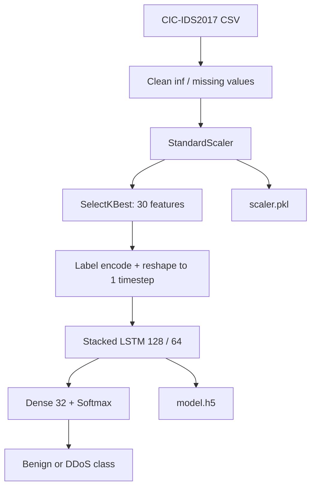

# Network Intrusion / DDoS Classification with LSTM

**Project 001 · Deep Learning**  
**Path:** `DeepLearning/AI_cyber`

## Objective
Classify network-flow records from the CIC-IDS2017 Friday afternoon DDoS capture as benign or DDoS using a stacked LSTM classifier. This is a research/learning experiment, not a validated network security control.

## Data
The notebook reads `data.csv/Friday-WorkingHours-Afternoon-DDos.pcap_ISCX.csv`. Captured notebook output reports 225,745 rows and 79 columns before feature selection. It replaces infinite values, fills missing numeric values with column means, standardizes features and selects 30 features using `SelectKBest(f_classif)`. The selected data is exported to `scaled.csv`.

## Model and training
- Labels are encoded with `LabelEncoder`.
- Features are reshaped to one timestep with 30 features per record.
- Stacked LSTM: 128 units (sequence output) → 64 units → Dense(32, ReLU) → softmax over encoded classes.
- Adam optimizer, sparse categorical cross-entropy, batch size 32, up to 10 epochs.
- The notebook defines EarlyStopping and ModelCheckpoint objects but does not pass them into `model.fit`.
- Saves `model.h5` and `scaler.pkl`; `test.py` loads the model and predicts one hard-coded row from `scaled.csv`.

## Architecture

## Run
Use a Python environment with TensorFlow/Keras, Pandas, NumPy, scikit-learn, joblib and Jupyter. Ensure the CSV is available at the exact relative path, then run `train.ipynb`. Run `python test.py` only after the expected artifacts and `scaled.csv` exist.

## Captured evidence and limitations
The notebook's saved output shows validation accuracy near 99.3% in early epochs; this is a historical notebook output, not a reproduced benchmark. The current test script hard-codes prediction of row 4 and maps class index 0 to benign and every other class to DDoS, rather than using the saved encoder. The split is not seeded or stratified. Feature selection and scaling occur before train/test split, causing data leakage. The validation set is used for fitting without the defined callbacks.

## Improvements
Fit imputation, scaling and feature selection on training data only; use stratified/time-aware evaluation; persist the label encoder and exact selected feature names; pass callbacks; report per-class precision/recall, confusion matrix and PR-AUC; validate the inference input schema and class mapping. Treat the model as an offline experiment until independently tested on temporally separate network traffic.
