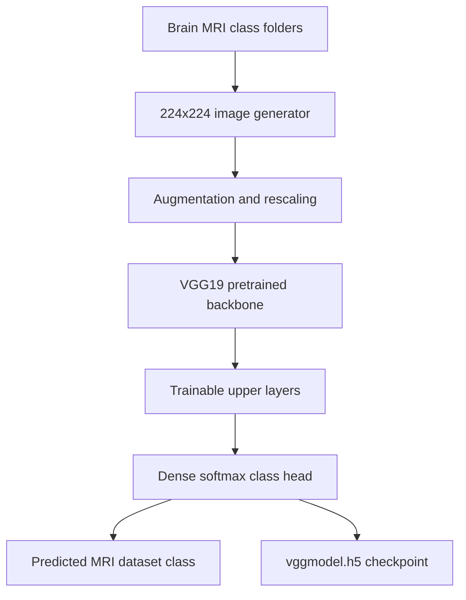

# Brain Tumour MRI Image Classification with VGG19 Transfer Learning

**Project 002 · Deep Learning**  
**Path:** `DeepLearning/Brain_tumour`

## Objective
Fine-tune the upper layers of an ImageNet-pretrained VGG19 network to classify brain MRI images into the class folders present in the dataset.

## Dataset
The notebook inspects `dataset/training` and reports 5,712 JPG images across four classes. It creates generators from `dataset/Training` and `dataset/Testing`; verify the case-sensitive directory names and class-folder parity before running. The dataset folder is checked in.

## Model
- Base: VGG19 with input size 224×224×3.
- The notebook attempts to remove the original classifier and freezes most of the base layers (all but the last four).
- A new Dense softmax output is sized to the discovered class count.
- Adam, categorical cross-entropy and accuracy.
- Image augmentation: shear, zoom, vertical shift and horizontal flip; rescaling by 1/255.
- Up to 20 epochs, batch size 16, EarlyStopping and best-validation-loss ModelCheckpoint to `vggmodel.h5`.

## Architecture

## Run
Install TensorFlow/Keras, NumPy, Matplotlib and Jupyter. Ensure `dataset/Training` and `dataset/Testing` exist with identical class subdirectories. Open and run `train.ipynb` from this directory. GPU is recommended.

## Captured evidence and limitations
The notebook output reports 5,712 training images and 1,311 test images across four classes. The captured execution output is incomplete during epoch 1, so no final accuracy is claimed. The notebook calls `model.layers.pop()` without rebuilding the functional graph; inspect model summary and output wiring in the installed Keras version. It also uses the test generator as validation data during training, which contaminates final test evaluation. The same augmented generator is used for testing, so test-time augmentation is unintentionally enabled.

## Improvements and responsible use
Use a separate validation split and untouched test set; apply augmentation only to training; verify model graph after classifier replacement; save class indices and preprocessing configuration; report confusion matrix, sensitivity and specificity. MRI predictions are educational only and must not be used to diagnose, triage or guide patient care without rigorous clinical validation.
