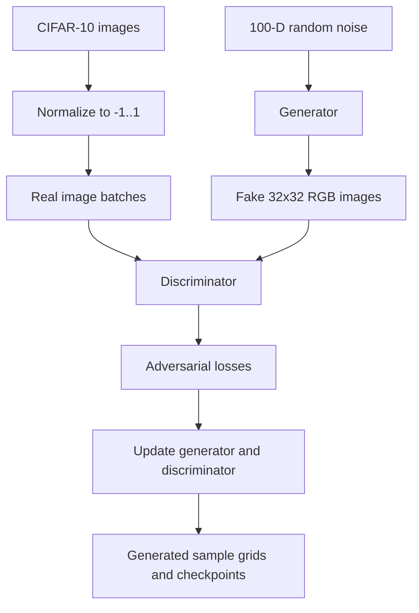

# CIFAR-10 Image Generation with a Deep Convolutional GAN

**Unindexed DeepLearning directory — project ID requires inventory reconciliation**  
**Path:** `DeepLearning/DC-GAN`

## Objective and data
An experimental Deep Convolutional Generative Adversarial Network (DCGAN) that learns to generate 32×32 RGB images from the CIFAR-10 training images. The notebook loads CIFAR-10 through Keras and normalizes pixels to [-1,1].

## Architecture
- Latent noise vector: 100 dimensions.
- Generator: Dense projection to 8×8×256, batch normalization and LeakyReLU; transposed convolutions produce 8×8×128, 16×16×64 and 32×32×3; final activation tanh.
- Discriminator: Conv2D 64 and 128 filters with stride 2, LeakyReLU and dropout, flatten and Dense output.
- Separate Adam optimizers at 1e-4; custom adversarial losses; 30 epochs; batch size 256.
- TensorFlow checkpointing every 15 epochs and sample image generation.

## Flow

## Files and run
- `GAN.ipynb` — experiment and sample generation.
- `gan.py` — notebook-exported script.
Install TensorFlow/Keras, NumPy, Matplotlib and Jupyter. Run notebook/script with a TensorFlow-compatible GPU where possible.

## Critical implementation issue
The discriminator's final Dense layer has three outputs, while the adversarial loss is written as a real/fake binary cross-entropy. A standard DCGAN discriminator should return one logit per image (or use a clearly defined multi-output objective). The sample visualization displays only channel 0 rather than RGB. Training is hard-pinned to `/device:GPU:0`, which fails on CPU-only systems. These issues need correction before trusting the experiment.

## Evaluation and improvements
No reliable FID/IS or human evaluation is recorded. Use a one-logit discriminator, support CPU/GPU selection, save full model/config, visualize RGB samples, track generator/discriminator losses, and evaluate diversity and fidelity. This is a CIFAR-10 class-agnostic generator, not a class-conditional GAN.
