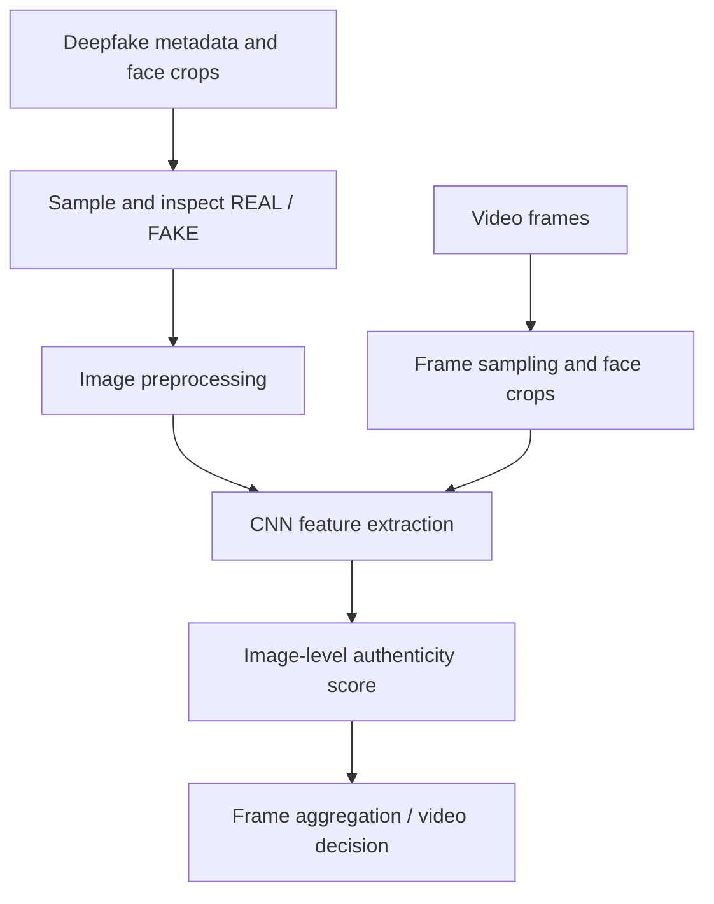

# Deepfake Image and Video Detection with CNN/RNN

**Unindexed DeepLearning directory — project ID requires inventory reconciliation**  
**Path:** `DeepLearning/DeepFake`

## Objective
An experimental workflow intended to distinguish authentic and manipulated face imagery, with an intended extension to video-level deepfake detection. The notebook describes 224×224 face crops from the Deepfake Detection Challenge dataset and notes that only a sample is used due to memory constraints.

## Data and stack
The notebook reads a metadata CSV containing labels such as `REAL` and `FAKE`, references extracted face images, and imports TensorFlow, scikit-learn, OpenCV, Pandas, NumPy, Plotly and Matplotlib. The checked-in artifact is `deep-fake-detection-on-images-and-videos.ipynb`; a related image titled `- 28 — Deepfake Image Generation.png` is an illustration asset, not model code.

## Intended pipeline

## Execution
The notebook is Kaggle-oriented and expects dataset paths under `../input/`. Install compatible TensorFlow, OpenCV, scikit-learn, Pandas, NumPy and plotting packages, then configure local paths before running.

## Evidence and limitations
The notebook's title and narrative state CNN/RNN-based image and video detection, but the checked-in notebook was not fully reconstructed into a verified, runnable end-to-end pipeline in this static review. It explicitly samples data because of memory limits. No trustworthy final accuracy, AUC or video-level evaluation result is claimed. Dataset split leakage, class imbalance, compression/domain shift and face-crop provenance must be checked before any conclusions.

## Improvements and responsible use
Document the exact model layers and training split, add video-level aggregation and temporal evaluation, report ROC-AUC/PR-AUC and confusion matrix, test across source datasets and compression levels, and preserve dataset licenses. Use as a research detector only; model scores are uncertain and must not be treated as proof that media is authentic or manipulated.
