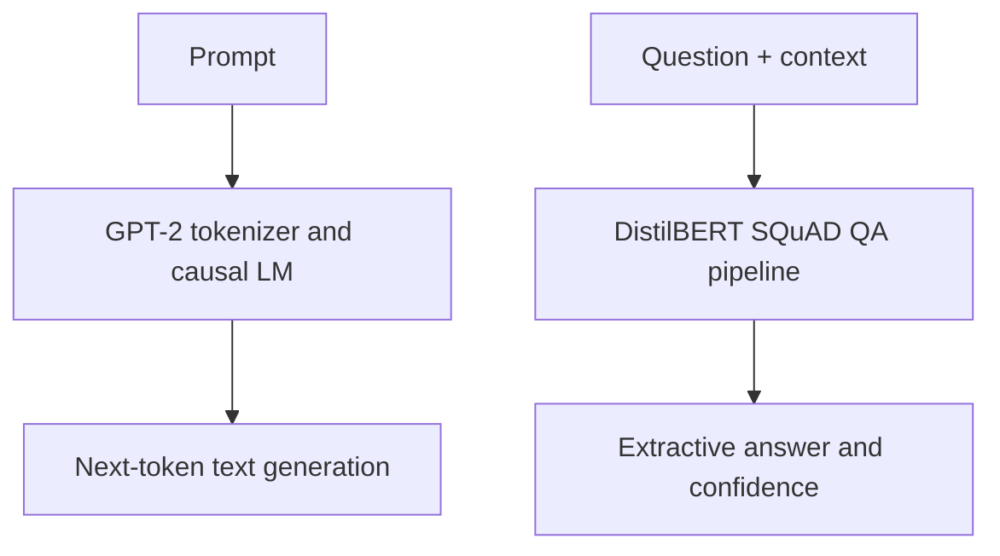

# GPT-2 Text Generation and Transformer Question Answering Demo

**Unindexed DeepLearning directory — project ID requires inventory reconciliation**  
**Path:** `DeepLearning/GPT-2`

## Purpose
A small Hugging Face Transformers notebook demonstrating pretrained GPT-2 causal language modeling and a separate extractive question-answering pipeline.

## What the notebook does
1. Loads `gpt2` with `AutoModelForCausalLM` and its tokenizer, then defines a short prompt.
2. Loads `distilbert-base-uncased-distilled-squad` using `AutoModelForQuestionAnswering`.
3. Creates a `question-answering` pipeline and asks a question against the prompt context.
4. The captured output returns the answer `OpenAI` with score about 0.956 for the example question.

## Architecture

## Files and run
- `GPT_2.ipynb`
Install `transformers`, `torch` and Jupyter. Run the notebook; pretrained checkpoints are downloaded from Hugging Face and internet access is required on first use.

## Important distinction
The notebook loads GPT-2 but does not show a completed GPT-2 fine-tuning workflow or a call to generate text from GPT-2 in the inspected cells. The displayed answer is produced by the separate DistilBERT question-answering model, not GPT-2. The command `pip install huggingface` is not the usual package needed for this workflow; use the maintained `transformers` package and its dependencies.

## Improvements
Add an explicit GPT-2 `generate()` example with decoding parameters, distinguish generation from extractive QA, pin model/library versions, include a reusable inference function and document model limitations, safety and licensing.
