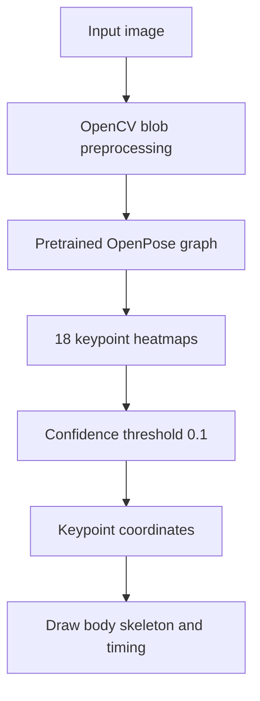

# Human Pose Estimation with OpenPose (OpenCV DNN)

**Project 003 · Deep Learning / Computer Vision**  
**Path:** `DeepLearning/Human_pose`

## Objective
Estimate 2D human body keypoints in an image and draw skeletal connections using a pretrained OpenPose-style TensorFlow graph loaded through OpenCV's DNN module.

## Implementation
The notebook clones `quanhua92/human-pose-estimation-opencv`, loads `graph_opt.pb`, and uses OpenCV's `readNetFromTensorflow`. It defines 18 body-part indices (nose, neck, shoulders, elbows, wrists, hips, knees, ankles, eyes and ears) and 17 skeletal pairs.

For an image:
1. Create a normalized blob using mean (127.5,127.5,127.5), swap RGB channels and forward it through the network.
2. Keep the 18 heatmaps.
3. Find each heatmap's maximum-confidence location.
4. Convert heatmap coordinates to image coordinates and accept points above threshold 0.1.
5. Draw lines and keypoint circles for detected pairs and annotate inference time.

## Architecture

## Files and setup
Main artifact: `1.ipynb`. The notebook clones model/code assets into `human-pose-estimation-opencv/`; the repository does not include that dependency as a standalone checked-in submodule. Install OpenCV, NumPy, Matplotlib and Jupyter. Run notebook cells after obtaining the referenced graph and sample image.

## Limitations
The saved notebook output indicates the clone command failed because the destination directory already existed; verify the graph and sample image paths manually. The notebook processes a single hard-coded image, not a live camera/video stream. It uses a fixed confidence threshold and does not perform temporal tracking or multi-person identity association. The timing measurement is OpenCV DNN forward-pass profiling, not full application latency.

## Improvements
Add path checks and download instructions for model weights, support webcam/video input, handle multiple people and confidence calibration, expose input size and threshold as configuration, and document the model/license provenance. Pose keypoints can be sensitive; avoid retaining identifiable imagery without consent.
