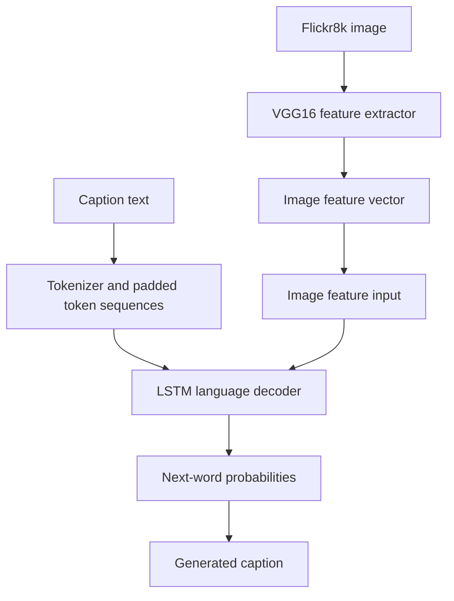

# Image Caption Generation with VGG16 and LSTM

**Unindexed DeepLearning directory — project ID requires inventory reconciliation**  
**Path:** `DeepLearning/ImageCaption`

## Objective
Generate a natural-language caption for an image by combining visual features extracted from pretrained VGG16 with an LSTM-based sequence decoder. The notebook targets the Flickr8k dataset.

## Data and feature extraction
- Dataset root is configured as `/kaggle/input/flickr8k`.
- Images are resized to 224×224 and preprocessed with VGG16's `preprocess_input`.
- VGG16's penultimate layer is used as an image feature extractor.
- Extracted image vectors are saved to `features.pkl`.
- Captions are read from `captions.txt`, cleaned, and wrapped with `startseq` and `endseq` tokens.

## Model flow

## Stack and run
Notebook: `imagecaptioning.ipynb`. Python, TensorFlow/Keras, VGG16, NumPy, Pandas, Pillow, tqdm and pickle. The current paths are Kaggle-specific; mount Flickr8k or update `base_dir` and `working_dir` before running.

## Important code-review findings
The notebook's caption parsing contains a suspicious condition `if len(line) > 2: continue`, which appears to skip most normal caption rows rather than retaining them. Its cleaning function uses string replacement with regex-looking patterns instead of `re.sub`, so punctuation and whitespace may not be cleaned as intended. The complete model-training cells and generated captions were not independently validated in this review. Pickle files should only be loaded from trusted sources.

## Improvements
Correct caption parsing and cleaning, split train/validation/test by image ID to avoid caption leakage, save tokenizer and max sequence length, add beam-search/greedy decoding, evaluate BLEU/CIDEr/SPICE with clear caveats, and provide a single-image inference script.
