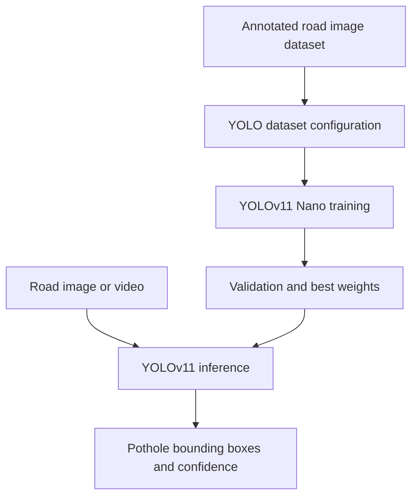

# Pothole Detection with YOLOv11 Nano

**Unindexed DeepLearning directory — project ID requires inventory reconciliation**  
**Path:** `DeepLearning/Path-hole`

## Objective
An object-detection notebook for identifying potholes in road imagery using Ultralytics YOLOv11 Nano. The notebook title identifies the model variant and the captured installation output shows Ultralytics 8.3.75 and a Colab T4 GPU environment.

## Workflow evidenced by the notebook
- Installs Ultralytics and Roboflow-related dependencies.
- Uses a Roboflow dataset workflow and Ultralytics tooling.
- Intended sequence: prepare annotated pothole dataset, configure YOLOv11n, train/validate, and run inference on road images or video.
- Notebook filename: `39 — Pothole Detection using YOLOv11 Nano.ipynb`.

## Architecture

## Run
The notebook is Colab-oriented and expects GPU acceleration. Install a compatible `ultralytics` release and configure Roboflow credentials through a secure environment/Colab secret (never hard-code or commit API keys). Execute the notebook from top to bottom after confirming dataset workspace/version and YAML configuration.

## Verification boundary
The inspected notebook metadata and dependency output establish the YOLOv11/Roboflow workflow, but this review did not independently reproduce dataset download, training, or validation. Do not infer accuracy or deployment readiness from package-install output alone. Dataset version, class mapping, split integrity, training arguments and final weight artifact should be recorded explicitly.

## Improvements
Move credentials to secrets, pin package versions, preserve the dataset YAML and training command, save best/last checkpoints, report mAP50 and mAP50-95 plus per-class precision/recall, test on unseen road conditions, and provide video inference with frame-rate measurement. Pothole detections should be reviewed before road-maintenance decisions.
