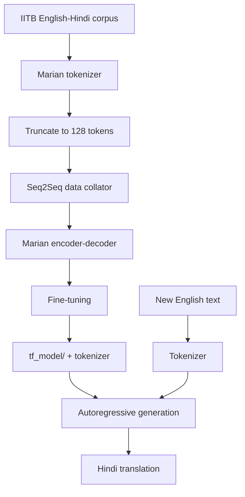

# English-to-Hindi Neural Machine Translation with MarianMT

**Project 004 · Deep Learning / NLP**  
**Path:** `DeepLearning/SEQ_SEQ`

## Objective
Fine-tune a pretrained sequence-to-sequence translation model for English-to-Hindi translation using the IIT Bombay English-Hindi parallel corpus.

## Model and data
- Checkpoint: `Helsinki-NLP/opus-mt-en-hi` (MarianMT family).
- Dataset: `cfilt/iitb-english-hindi` from Hugging Face Datasets.
- Tokenizer truncates source and target sequences to 128 tokens.
- TensorFlow model: `TFAutoModelForSeq2SeqLM`.
- Data collator: `DataCollatorForSeq2Seq`.
- Training configuration: batch size 16, learning rate 2e-5, weight decay 0.01, one epoch.
- Saves the fine-tuned model under `tf_model/` and demonstrates generation from a sample English paragraph.

## Architecture

## Run
Install compatible versions of `transformers`, `datasets`, TensorFlow and Jupyter. Internet access is needed for initial dataset and checkpoint downloads. Run `transformer.ipynb` top to bottom.

## Important implementation issue
The notebook creates `train_dataset` from the dataset's **test** split, while a separate validation dataset is built from `validation`. Training on test data invalidates the test set as an unbiased evaluation. Use the train split for training and keep test untouched until final evaluation. The notebook sets a one-epoch demonstration run and does not provide BLEU/chrF or other translation-quality metrics. The saved notebook contains no reliable final metric output.

## Improvements
Correct the training split, add a validation strategy and held-out test evaluation, compute BLEU/chrF with documented tokenization, compare pretrained baseline against fine-tuned output, pin TensorFlow/Transformers versions, and provide batch inference plus language/quality limitations.
