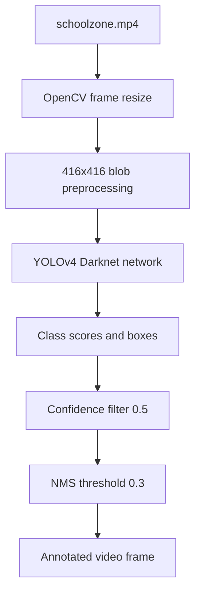

# Real-Time Object Detection with YOLOv4 and OpenCV

**Project 005 · Deep Learning / Computer Vision**  
**Path:** `DeepLearning/Yolo`

## Objective
Run pretrained YOLOv4 object detection on the included `schoolzone.mp4` video using OpenCV's Darknet DNN backend and draw labeled bounding boxes.

## Model assets
- `YOLO_V4/yolov4.cfg` — Darknet model configuration.
- `YOLO_V4/yolov4.weights` — pretrained weights.
- `YOLO_V4/coco.names` — COCO class labels.
- `schoolzone.mp4` — input video.
The notebook also contains download commands for upstream YOLOv4 assets.

## Detection pipeline
1. Load class labels, configuration and weights.
2. Initialize OpenCV `readNetFromDarknet`.
3. Read video frames and resize to width 500.
4. Build a 416×416 RGB-swapped blob scaled by 1/255.
5. Forward through YOLO output layers.
6. Select the highest class score per detection; confidence threshold 0.5.
7. Apply Non-Maximum Suppression with threshold 0.3.
8. Draw bounding boxes and class labels.

## Architecture

## Run
Install OpenCV, NumPy, imutils and wget. Verify the three YOLO assets exist under `YOLO_V4/`, then run `train.ipynb` in Jupyter. The notebook is a video-inference demo; it does not train YOLOv4.

## Limitations
The notebook uses a Windows/Colab mixed set of commands (including `!PWD`) and assumes the video can be opened. It should check the return flag from `VideoCapture.read()` before resizing a frame, release the capture, and close windows at the end. The displayed label formats confidence with a percent sign although the score is a 0–1 probability-like confidence. No dataset-specific fine-tuning or school-zone vehicle/pedestrian evaluation is implemented.

## Improvements
Add robust CLI/video path handling, frame-read checks, FPS measurement, output-video writing, class filtering for traffic participants, and evaluate detection precision/recall on labeled local road footage. Do not describe this as a custom-trained school-zone model.
