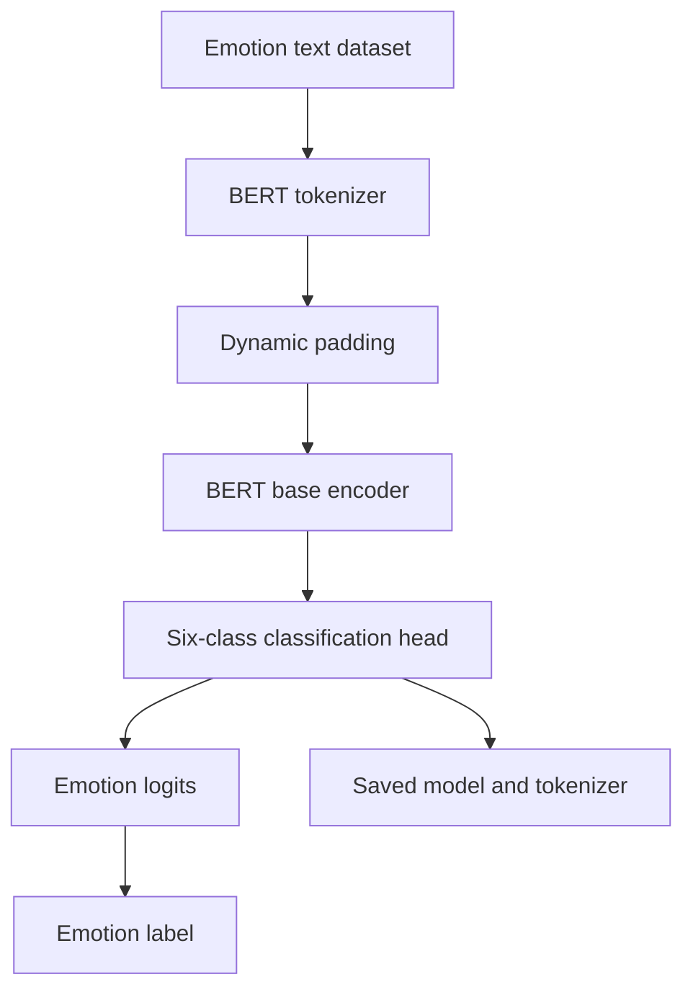

# Emotion Classification with BERT

**Unindexed DeepLearning directory — project ID requires inventory reconciliation**  
**Path:** `DeepLearning/bert_for_emotion`

## Objective and dataset
Fine-tune `bert-base-cased` for six-way emotion classification using the Hugging Face `dair-ai/emotion` dataset configuration `split`. The labels in the notebook are sadness, joy, love, anger, fear and surprise.

## Training pipeline
- Tokenize text with the BERT tokenizer, truncation and dynamic padding.
- Load `AutoModelForSequenceClassification` with six output labels.
- Use `DataCollatorWithPadding`.
- Trainer settings: learning rate 2e-5, batch size 16 for train/evaluation, five epochs, weight decay 0.01, FP16 requested.
- Save model and tokenizer to `/content/bert_emotion` and `/content/bert_tokenizer`.
- Define `predict_emotion(text)` to tokenize input and map the argmax class to the six emotion names.

## Architecture

## Run
Notebook: `bert_for_emotion.ipynb`. Install PyTorch, Transformers, Datasets, Accelerate and Jupyter. The notebook uses Colab output paths and requests CUDA/FP16; adjust paths and disable FP16 when no supported GPU is available.

## Limitations
The test split is passed as Trainer's evaluation dataset during training, so it is not an untouched final test set. The inference function hard-codes `cuda`, making CPU-only inference fail. It runs the model twice per input (once with discarded output, then again for logits). The model head is newly initialized and requires fine-tuning; the saved output only confirms a sample label ("sadness"), not a validated quality metric. The dataset's six labels are affect annotations, not a reliable measure of a person's actual mental state.

## Improvements
Use a validation split from training data and reserve test for final evaluation; compute macro-F1 and per-class metrics; add device selection and one forward pass; persist label2id/id2label; document demographic and language limitations, and avoid using predicted emotion for consequential or sensitive decisions.
