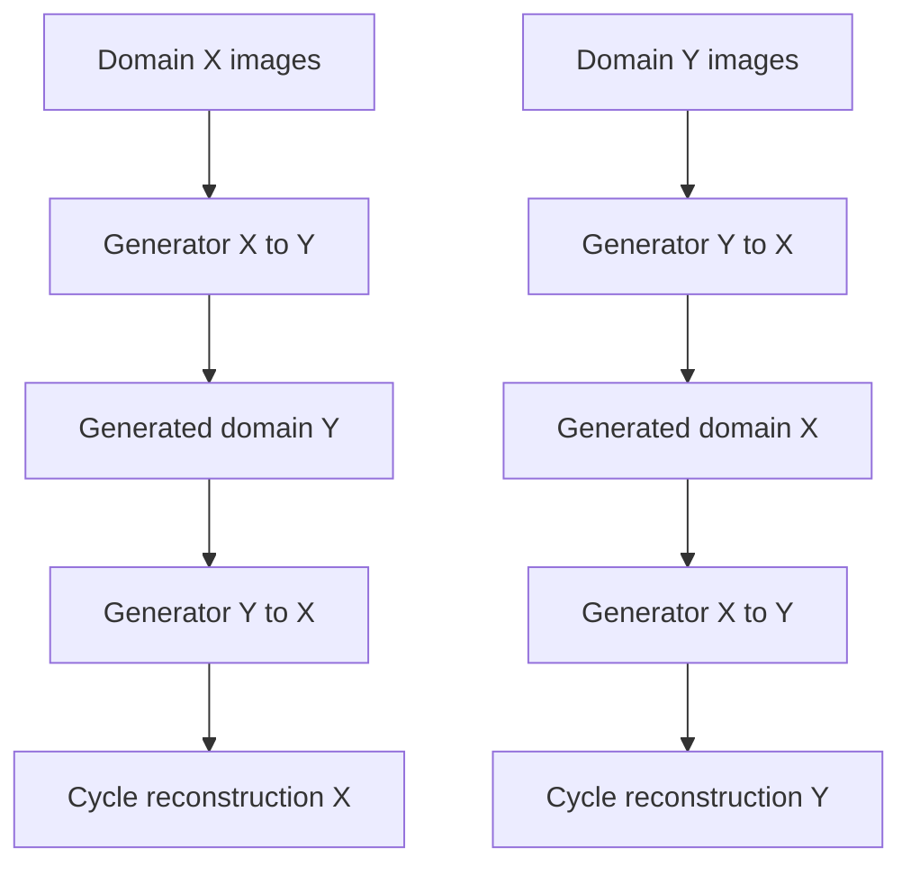

# CycleGAN Image-to-Image Translation Experiment

**Unindexed DeepLearning directory — project ID requires inventory reconciliation**  
**Path:** `DeepLearning/cycle-GAN`

## Objective
A second CycleGAN notebook artifact in the DeepLearning folder. Its notebook `cycle_gan.ipynb` should be treated as a separate repository implementation from `style_transfer/cycle_gan.ipynb` until code-level comparison confirms whether it is a duplicate or a distinct experiment.

## Audit status
The sibling `style_transfer` project contains a documented horse↔zebra CycleGAN implementation using TensorFlow Datasets, Pix2Pix U-Net generators, PatchGAN discriminators, cycle-consistency and identity losses. The root `cycle-GAN` notebook is present as a separate 1 MB notebook; the full cell-level behavior and dataset/model configuration have not yet been confirmed in this pass. No claims about its dataset, training configuration, output quality or metrics are made here.

## Expected conceptual CycleGAN flow

## Run and verification
Open `cycle_gan.ipynb` and inspect its dataset acquisition, model definitions and training cells before execution. TensorFlow and Jupyter are likely required based on the notebook's domain, but confirm imports before installing dependencies. Training was not executed during documentation review.

## Required follow-up
Compare this notebook with `style_transfer/cycle_gan.ipynb` cell-by-cell; if they implement the same dataset/task, merge documentation and mark one as duplicate/alternate copy in the project inventory. If distinct, document the actual dataset, model layers, loss functions, training schedule, checkpoints and evaluation results. Do not infer equivalence from the filename alone.
