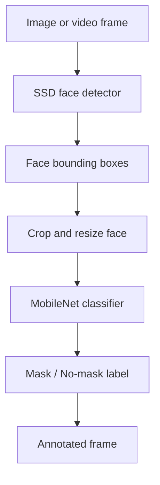

# Face Mask Detection with SSD Face Detector and MobileNet Classifier

**Project 006 · Deep Learning / Computer Vision**  
**Path:** `DeepLearning/maskdetector/25- Face Mask detector`

## Objective
Detect faces in images/video frames and classify each detected face as mask-wearing or not using a pretrained SSD face detector and a MobileNet-based Keras classifier.

## Checked-in assets
- `deploy.prototxt` and `res10_300x300_ssd_iter_140000.caffemodel` — OpenCV SSD face detector configuration and weights.
- `model_mobilenet.h5` — trained mask classification model.
- `dataset/` — dataset directory.

The nested directory `25- Face Mask detector/25- Face Mask detector/` and the dataset folder are present; inspect their contents before assuming a particular script path. This README documents the model artifacts confirmed at this project root.

## Architecture

## Stack and setup
Python, OpenCV DNN, TensorFlow/Keras, NumPy and the files listed above. A complete reproducible command cannot be confirmed from the root listing alone; inspect the nested implementation folder for the actual entry point and required input paths.

## Limitations and responsible use
No independent accuracy, dataset split or fairness evaluation is established by the checked-in artifacts alone. Face detection and mask classification can fail under occlusion, low light, pose variation and domain shift. Do not use this prototype for identity recognition, access control or punitive enforcement. Avoid storing face images and obtain consent where required.

## Improvements
Document the nested source files and model provenance, add a stable inference entry point, validate image preprocessing against training, report per-class precision/recall and false-positive rates, and test across lighting, skin-tone and camera conditions.
