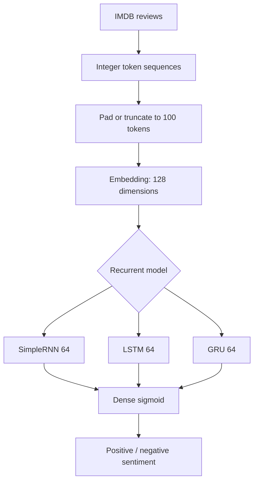

# Recurrent Neural Network Comparison for IMDB Sentiment Classification

**Project 007 · Deep Learning / NLP**  
**Path:** `DeepLearning/preditive` (repository spelling retained)

## Objective
Compare SimpleRNN, LSTM and GRU sequence models on the binary IMDB movie-review sentiment dataset.

## Shared data pipeline
Each notebook loads the Keras IMDB train/test splits, pads token sequences to length 100, and uses an embedding layer with dimension 128. The declared vocabulary size is 500,000. Each model ends with a single sigmoid output and is trained with binary cross-entropy and accuracy.

## Model variants
| Notebook | Recurrent layer | Optimizer | Early stopping |
|---|---|---|---|
| `rnn1.ipynb` | SimpleRNN(64) | SGD, learning rate 0.001 | patience 5 |
| `lstm1.ipynb` | LSTM(64, tanh) | SGD default settings | patience 5 |
| `gru1.ipynb` | GRU(64, tanh) | SGD default settings | patience 3 |

Each run uses up to 10 epochs and plots training/validation accuracy and loss.

## Architecture

## Run
Install TensorFlow/Keras, NumPy, Matplotlib and Jupyter. Run each notebook independently from this folder. Dataset download is handled by Keras on first run.

## Captured outputs and caveats
Saved outputs for the three notebooks show test accuracy in the high-60% range in the displayed runs (approximately 67.9% SimpleRNN, 68.5% LSTM and 68.7% GRU). The GRU notebook prints the values with the labels reversed: `test_loss` receives accuracy and `test_acc` receives loss. These are historical notebook outputs, not a controlled comparison. The same test set is used as validation data during training, and model vocabulary size is unnecessarily large relative to the Keras IMDB word index.

## Improvements
Use a validation split from training data and retain test for final evaluation; use identical seeds, optimizer, training budget and preprocessing for fair comparison; correct metric labels; compare accuracy, precision/recall, F1 and confusion matrix; save tokenizer/word-index and model artifacts for inference; document per-epoch results.
