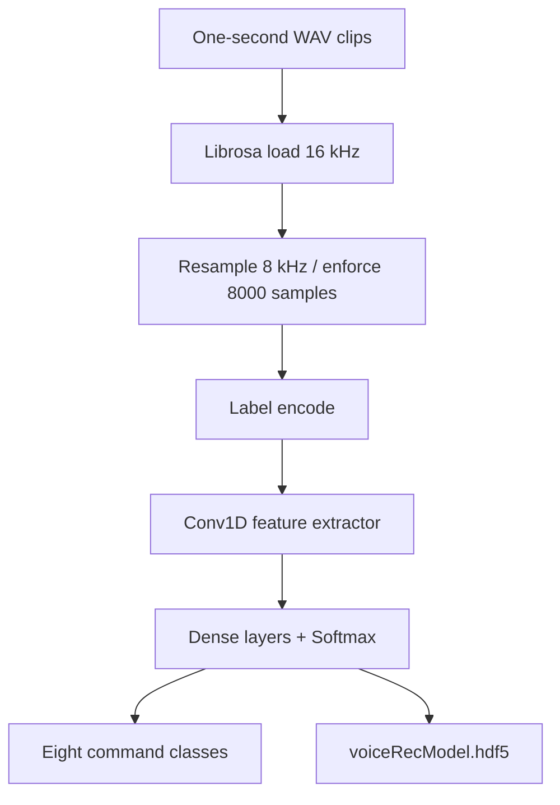

# Speech Command Recognition with 1D CNN

**Project 008 · Deep Learning / Audio**  
**Path:** `DeepLearning/speech`

## Objective
Classify short audio clips into eight speech-command classes using a one-dimensional convolutional neural network operating on waveform samples.

## Dataset and preprocessing
The notebook uses a Speech Commands-style directory at `train/` and explicitly selects: `bed`, `bird`, `cat`, `dog`, `down`, `eight`, `five`, `four`. Audio is loaded with librosa at 16 kHz, resampled to 8 kHz, and retained only when the waveform has exactly 8,000 samples (one second). Labels are integer-encoded and one-hot encoded. Captured output reports per-class counts and a stratified 80/20 split with 10,448 training and 2,613 validation examples.

## Model
Four Conv1D blocks (8, 16, 32, 64 filters; kernel sizes 13, 11, 9, 7), each with max pooling and dropout 0.3, followed by Flatten, Dense(256), Dense(128), dropout and an eight-unit softmax. Adam and categorical cross-entropy are used. Training is configured for up to 100 epochs with EarlyStopping and ModelCheckpoint.

## Architecture

## Run
Install librosa, SciPy, NumPy, scikit-learn, TensorFlow/Keras, Matplotlib and Jupyter. Ensure class-named WAV folders exist under `train/`, then run `train.ipynb`. The notebook also contains an audio playback and prediction example.

## Limitations
The notebook's ModelCheckpoint monitors `val_acc`, while the compiled metric is named `accuracy`; depending on Keras version this may prevent checkpoint saving. The final `model.save` overwrites the checkpoint with the last-epoch model. No final numeric accuracy was captured in the inspected output. The notebook uses a random split of clips; speaker leakage may occur if multiple recordings from the same speaker are split across train and validation.

## Improvements
Monitor `val_accuracy`, save the best checkpoint without overwriting it, split by speaker where metadata permits, report per-class metrics and confusion matrix, support arbitrary clip duration via padding/truncation, and persist label mapping and sample-rate settings with the model.
