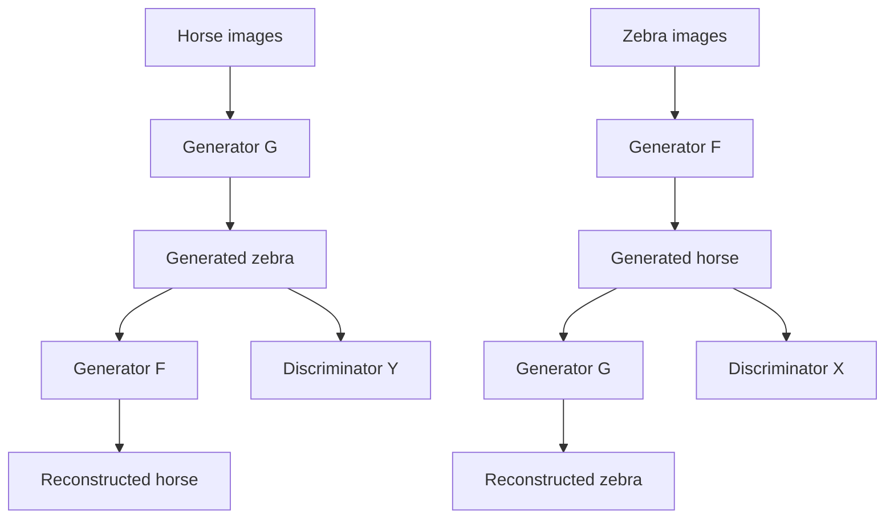

# Unpaired Horse-to-Zebra Image Translation with CycleGAN

**Project 009 · Deep Learning / Generative Vision**  
**Path:** `DeepLearning/style_transfer`

## Objective
Demonstrate unpaired image-to-image translation from horses to zebras using the TensorFlow Datasets `cycle_gan/horse2zebra` dataset and TensorFlow's Pix2Pix example model components.

## Model
- Two U-Net generators: horse→zebra (G) and zebra→horse (F).
- Two PatchGAN-style discriminators, one per domain.
- 256×256 RGB images, batch size 1, 50 epochs.
- Random jittering: resize to 286×286 then random crop to 256×256.
- Random horizontal mirroring and normalization to [-1,1].
- Adversarial binary cross-entropy, cycle-consistency loss (lambda 10) and identity loss (lambda 5).
- Adam optimizers at 2e-4 with beta_1=0.5.
- Checkpoint manager retains up to five checkpoints.

## Architecture

## Run
Install TensorFlow, TensorFlow Datasets, Matplotlib, Jupyter and the TensorFlow Examples Pix2Pix helper package compatible with the notebook. Run `cycle_gan.ipynb`; the dataset is downloaded by TFDS and checkpoints are written to `checkpoints/train`.

## Critical notebook issue
The inspected `preprocess_traindata(images, labels)` function refers to `image` rather than its `images` parameter, and its return value omits the label as expected by the dataset map signature. This is likely to stop the input pipeline. Fix the parameter name and return structure before expecting a complete training run. The notebook has no captured end-to-end training metrics.

## Improvements
Add a smoke test for dataset preprocessing, record generated sample grids per epoch, evaluate FID/KID or a human review protocol, document the pretrained helper dependency/version, and keep domain-specific train/test data disjoint. This is an unpaired translation demonstration, not a general-purpose style-transfer service.
