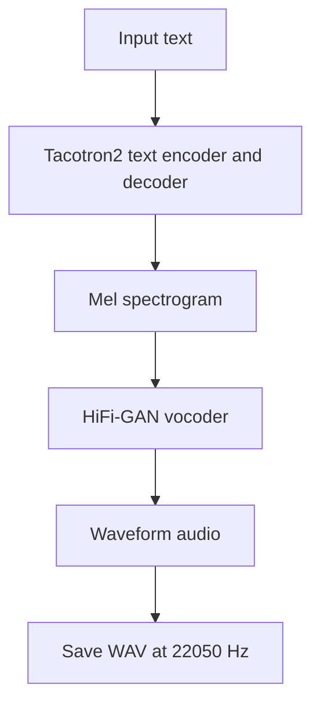

# Text-to-Speech with Tacotron2 and HiFi-GAN

**Unindexed DeepLearning directory — project ID requires inventory reconciliation**  
**Path:** `DeepLearning/tactron` (repository spelling retained)

## Objective
Generate speech audio from text using SpeechBrain's pretrained Tacotron2 acoustic model and HiFi-GAN neural vocoder.

## Implementation
The notebook `tts.ipynb`:
1. Installs SpeechBrain and imports TorchAudio.
2. Loads `speechbrain/tts-tacotron2-ljspeech` and `speechbrain/tts-hifigan-ljspeech` pretrained checkpoints.
3. Encodes text into mel-spectrogram representations using Tacotron2.
4. Converts mel outputs into waveform audio with HiFi-GAN.
5. Saves output WAV files at 22,050 Hz.
A second example uses a legacy SpeechBrain import path and another model identifier; compatibility should be checked against the installed SpeechBrain release.

## Architecture

## Run
Install compatible SpeechBrain, PyTorch and TorchAudio versions, then run `tts.ipynb`. Initial execution downloads pretrained checkpoints into local cache directories `tmpdir_tts` and `tmpdir_vocoder`. Ensure the TorchAudio build matches the installed PyTorch build.

## Limitations
This is inference with pretrained models, not a Tacotron2 training project. No voice cloning, custom speaker adaptation or quality benchmark is implemented. The notebook uses a short fixed English text sample and saves generated WAV output; it does not expose an application/API.

## Improvements
Consolidate on current SpeechBrain APIs, pin compatible Torch/TorchAudio/SpeechBrain versions, wrap text-to-waveform in a reusable function, validate sample rate and output duration, add audio listening/evaluation guidance, and document model/dataset licenses and limitations.
