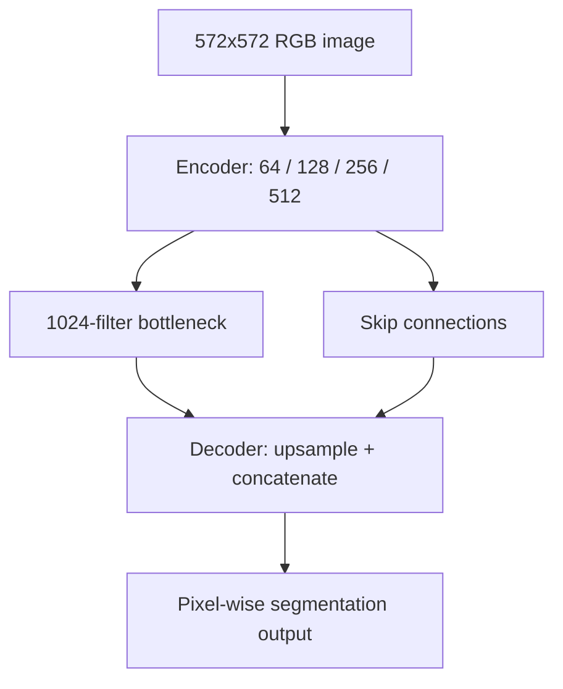

# U-Net Image Segmentation

**Project 010 · Deep Learning / Computer Vision**  
**Path:** `DeepLearning/unet_image_segmentation`

## Objective
Define a U-Net-style encoder-decoder convolutional network for pixel-level image segmentation.

## Model implementation
The notebook's `unet_model(input_size=(572,572,3))` defines an encoder with two Conv2D layers per stage (64, 128, 256 and 512 filters), max-pooling between stages, a 1024-filter bottleneck, and a decoder using transposed convolutions with skip connections via concatenation. Convolutions use ReLU, He-normal initialization and valid padding.

The model is compiled with Adam, binary cross-entropy and accuracy. The final cell calls `model.fit(train_dataset, validation_data=val_dataset, batch_size=32)`.

## Architecture

## Data and execution
Main artifact: `unet_is.ipynb`. The inspected notebook references `train_dataset` and `val_dataset`, but their construction and the source image/mask dataset are not present in the inspected cells/repository root. Install TensorFlow/Keras and Jupyter, then supply paired images and segmentation masks with a documented loader before running.

## Important limitations
The notebook's model definition is an architecture prototype rather than a complete reproducible segmentation pipeline. The final output layer and tensor dimensions must be checked against the target mask shape and class count; binary cross-entropy is appropriate only for compatible binary/multilabel mask targets. The training datasets are undefined in the visible notebook, and no evaluation metrics or saved model were confirmed.

## Improvements
Add a paired image-mask dataset loader, explicit output activation and mask encoding, IoU/Dice metrics, augmentation applied consistently to image-mask pairs, train/validation/test splits, checkpointing, inference/overlay visualization and dataset provenance. Report pixel-level performance rather than accuracy alone.
