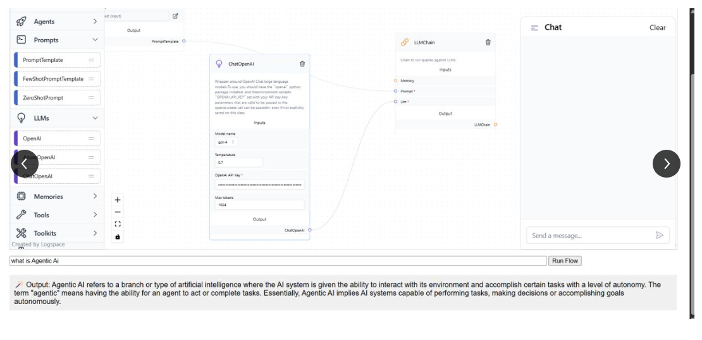
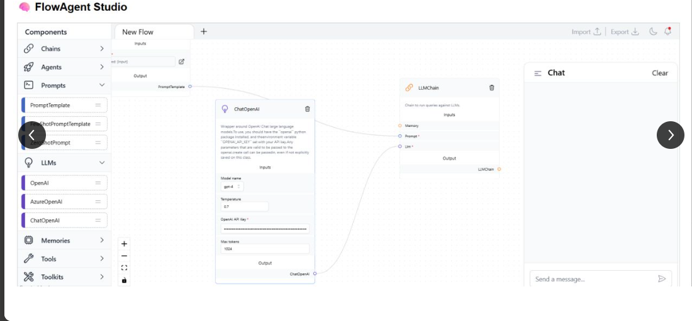
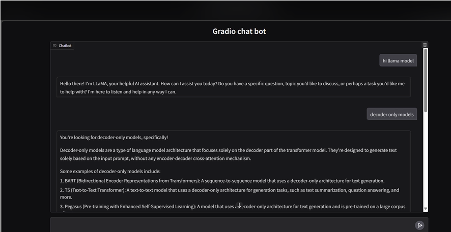

# Generative AI — Project Index

**Master catalogue:** [MASTER_PROJECT_CATALOGUE.md](../MASTER_PROJECT_CATALOGUE.md) · [Repository home](../README.md)

**Canonical inventory:** Projects 011–029 · **Total:** 19 source-bearing project folders  
**Audit:** [GENERATIVE_AI_AUDIT.md](../GENERATIVE_AI_AUDIT.md) · [Canonical register](../PROJECT_INVENTORY.md) · [Master catalogue](../README.md)

This index follows existing project IDs and paths. Documentation is based on checked-in source/configuration; no project is certified as runtime-verified or production-ready.

| ID | Project | Main technologies / pattern | Project documentation |
|---:|---|---|---|
| 011 | AgentAuditAI | AutoGen, LangSmith tracing, evaluator agent | [README](AgentAuditAI/AgentAudit/README.md) |
| 012 | Autofixer | Streamlit, LangChain, Groq code-repair prompt | [README](Autofixer/README.md) |
| 013 | ContextArchitect | LlamaIndex, Groq, BGE embeddings, local vector index | [README](ContextArchitect/ContextArtitext/README.md) |
| 014 | DecisionSim | CrewAI, LangGraph, AutoGen | [README](DecisionSim/README.md) |
| 015 | FinSightAI | Gemini, BGE embeddings, Chroma, financial-document RAG | [README](FinSightAI/README.md) |
| 016 | InsightServe | Streamlit, FastAPI, LangServe, ChatOpenAI | [README](InsightServe/README.md) |
| 017 | LLMStudioPro | LangChain, LangGraph ReAct, Tavily, FAISS/Chroma RAG | [README](LLMStudioPro/README.md) |
| 018 | LangAudit | Prompt variants, Groq, CSV logging, LangSmith imports | [README](LangAudit/README.md) |
| 019 | MCQ Generator | Groq, LangChain memory, Flask quiz API | [README](MCQ_GENERATOR/README.md) |
| 020 | MedicalSage | LlamaIndex, Groq, Pinecone, medical-document QA | [README](MedicalSage/README.md) |
| 021 | ProjectPilot | CrewAI + LangGraph research/writing workflow | [README](ProjectPilot/ProjectPilot/README.md) |
| 022 | ReportGenX | Streamlit, pandas, Matplotlib, Groq summaries | [README](ReportGenx/README.md) |
| 023 | ScheduleBot | Phidata agent, Groq, Google Calendar/Sheets APIs | [README](ScheduleBOT/ScheduleBot/README.md) |
| 024 | StateChatAI | LangGraph state wrapper around AutoGen | [README](StateChatAI/README.md) |
| 025 | TaskManager | CrewAI tasks and AutoGen group chat | [README](TaskManager/README.md) |
| 026 | WebAutoGPT | Flask, web search/scraping, LlamaIndex, GPT-4o | [README](WebAutoGPT/src/README.md) |
| 027 | DocQuery | FastAPI, Gradio, FAISS, OpenAI embeddings, Groq RAG | [README](docquery/README.md) |
| 028 | Visual Flow LLM Backend | FastAPI, LangChain, ChatOpenAI flow execution | [README](genai_1/backend/README.md) |
| 029 | Langflow JSON Loader API | FastAPI, Langflow flow loading | [README](genai_1/temp/README.md) |

## Additional reference material — Project 081

The separate [genai/](../genai/README.md) directory contains four PNG files. Three filenames explicitly carry the label 81 and appear to form one visual reference set for a Visual Flow LLM / LLM Debug Lab concept. The fourth file (llmdebulab.png) has no project number. These images are project references only; no matching implementation has been established from the images alone.

## Review priorities
1. Remove client-supplied API keys; add authentication, validation and redacted logs.
2. Improve RAG source metadata, citations, user isolation, index lifecycle and retrieval evaluation.
3. Restrict agent tools, isolate generated code, require confirmation for destructive actions and preserve human review.
4. Replace keyword-only grading with a labelled golden dataset and suitable evaluation.
5. Pin dependencies and add reproducible setup instructions and tests.

## Verification boundary
The 19 canonical folders were statically reviewed. The four image assets are references, not executable projects. No model calls, external APIs, agent workflows, training, server startup or end-to-end tests were run. See [Generative AI audit](../GENERATIVE_AI_AUDIT.md).
