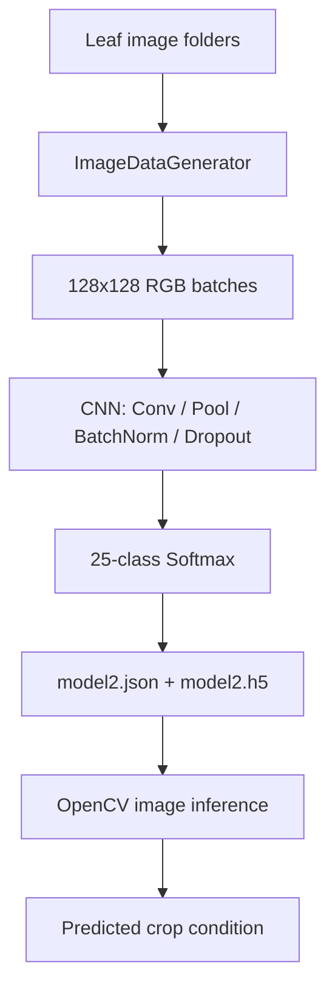

# Plant Disease Classification with CNN

**Project 030 · Domain:** Machine Learning · **Path:** `Machine_Learning/Disease`

## Overview
A convolutional neural network (CNN) experiment for classifying plant-leaf images into disease/healthy categories. The repository includes a training script, an image-inference script, a serialized model architecture, weights, and a PlantVillage-style image dataset.

## Problem
Identify the plant/crop condition represented by a leaf image, covering Apple, Corn, Grape, Potato and Tomato label families.

## Implementation
- `CNN_Train.py` builds a Keras Sequential CNN with convolution, max-pooling, batch-normalization and dropout blocks, followed by a 128-unit dense layer and a 25-class softmax output.
- Training uses directory-based image loading at 128×128, batches of 32, augmentation (shear, zoom and horizontal flip), Adam and categorical cross-entropy for 10 epochs.
- The model architecture is exported to `model2.json`; weights are written to `model2.h5`.
- `CNN_Test.py` loads the architecture and weights, reads an image with OpenCV, predicts a class and displays the selected label in the console.

## Architecture


## Repository contents
- `CNN_Train.py` — model definition and training.
- `CNN_Test.py` — single-image inference / Tkinter imports (the current script uses OpenCV display).
- `dataset/` — train and test image folders.
- `model2.json`, `model2.h5` — architecture and weights.

## Stack
Python, TensorFlow/Keras, NumPy, OpenCV, Tkinter, ImageDataGenerator.

## Run
From this directory, inspect the dataset folder names and ensure the training script's expected `dataset/train` and `dataset/val` paths exist. Then run:
```bash
python CNN_Train.py
python CNN_Test.py
```
The test script expects `model2.json`, `model2.h5` and a hard-coded sample image path relative to the working directory.

## Verification and limitations
Static source inspection completed; training was not rerun. The training script expects 25 output classes and hard-codes a 25-label list in inference, so directory class count/order must match exactly. The training generator uses `rescale=None` while the test generator rescales to [0,1], and inference does not apply the same normalization; this train/inference preprocessing mismatch should be corrected. The validation directory path and dataset contents should be checked before execution. No independently verified accuracy is claimed.

## Recommended improvements
Use one shared preprocessing function for train and inference; derive class labels from the saved class-index mapping; add a deterministic train/validation split, classification report and confusion matrix; save the full model and dependency versions; remove hard-coded local sample paths.
