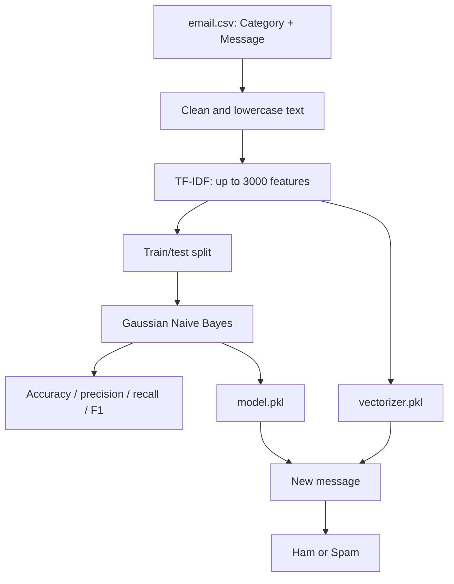

# Email Spam Classification

**Project 031 · Domain:** Machine Learning · **Path:** `Machine_Learning/Email_spam`

## Overview
A binary text-classification notebook that predicts whether an SMS/email-style message is spam or ham. The notebook trains a Naive Bayes classifier from the checked-in `email.csv` dataset and persists the fitted estimator and TF-IDF vectorizer.

## Dataset
`email.csv` contains 5,573 rows and two observed columns: `Category` and `Message`. The notebook filters an anomalous category value before training. The checked-in `archive (23).zip` is also present, but the notebook reads `email.csv` directly.

## Methodology
1. Load and inspect the message/category data with Pandas.
2. Remove non-letter characters using a regular expression and lowercase the message text.
3. Convert text to numeric features with `TfidfVectorizer` (maximum 3,000 features; English NLTK stop words).
4. Split data using `train_test_split(random_state=0)`.
5. Fit `GaussianNB` and evaluate using accuracy and a classification report.
6. Transform a sample message and predict ham/spam.
7. Persist `model.pkl` and `vectorizer.pkl` with pickle.

## Architecture


## Stack and files
- `train.ipynb` — preprocessing, training, evaluation and sample prediction.
- `email.csv` — source data.
- `model.pkl`, `vectorizer.pkl` — saved artifacts.
- Python, Pandas, NumPy, scikit-learn, NLTK, regex, Matplotlib, pickle.

## Run
```bash
cd Machine_Learning/Email_spam
python -m venv .venv
# Activate the environment, then install pandas numpy scikit-learn nltk matplotlib regex jupyter
jupyter lab
```
Open and run `train.ipynb` from top to bottom. Download the NLTK English stopwords corpus if it is not already available.

## Observed notebook result
The saved notebook output reports 1,393 test examples and approximately **88% accuracy**. The displayed class report shows class imbalance: class 0 has 1,208 test examples and class 1 has 185; spam-class precision is notably lower than recall. These are historical notebook outputs, not a fresh reproduction.

## Limitations and next steps
The notebook output includes a scikit-learn warning about a column-vector target. Ensure `y` is one-dimensional. Use a stratified split, compare MultinomialNB/LinearSVC, tune the decision threshold, and report per-class metrics and a confusion matrix. Save the complete preprocessing pipeline (vectorizer + classifier) to avoid inference-time mismatch. Validate the unusual category-filter expression and document the exact label mapping.
