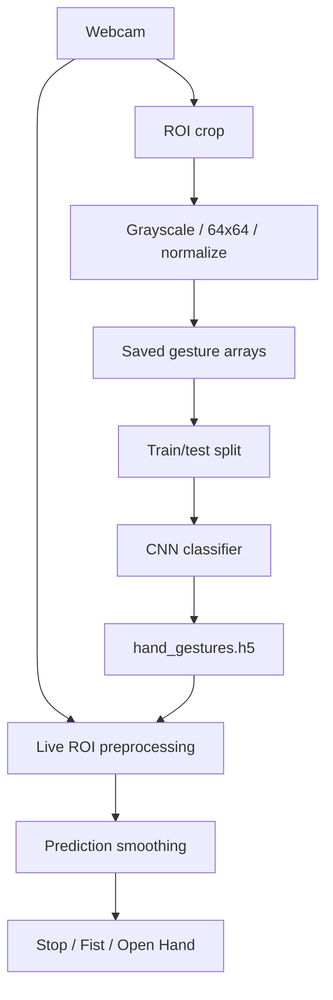

# Hand Gesture Recognition with CNN and OpenCV

**Project 032 · Domain:** Machine Learning · **Path:** `Machine_Learning/HandGesture`

## Overview
A webcam-based hand-gesture recognition experiment. The notebook collects labeled hand-region images, trains a small CNN on grayscale 64×64 inputs, saves the model, and demonstrates real-time prediction. A separate notebook demonstrates MediaPipe hand-landmark drawing.

## Gesture classes
The data-collection code maps keyboard labels `s`, `f`, and `o` to numeric classes 0, 1 and 2. The inference code maps these to **Stop**, **Fist**, and **Open Hand**.

## Workflow
1. Capture webcam frames using OpenCV.
2. Crop a fixed region of interest (ROI), convert to grayscale, resize to 64×64 and normalize pixel values.
3. Save arrays to `gesture_dataset/gesture_data.npy` and `labels.npy`.
4. One-hot encode labels and split into train/test sets (80/20, random state 42).
5. Train a Sequential CNN: Conv2D(32) → MaxPool → Dropout → Conv2D(64) → MaxPool → Dropout → Flatten → Dense(128) → Softmax.
6. Train for 10 epochs and save `hand_gestures.h5`.
7. Run webcam inference and smooth recent predictions with a 10-item majority-vote buffer.

## Architecture

## Files and stack
- `train.ipynb` — collection, CNN training, evaluation and webcam inference cells.
- `mp.ipynb` — MediaPipe hand landmark visualization using webcam frames.
- `gesture_dataset/` — collected arrays.
- `hand_gestures.h5` — trained model artifact.
- Python, OpenCV, TensorFlow/Keras, NumPy, scikit-learn, MediaPipe, Matplotlib.

## Run
Open `train.ipynb` in Jupyter and execute the collection cells first (webcam required), then training and inference cells. The model artifact is loaded by the live inference cell. Run `mp.ipynb` separately for landmark visualization.

## Observed evidence
The notebook output shows 335 training samples and 84 test samples. One saved run reports validation accuracy reaching 0.7143 in the first epoch; the full run should be repeated before treating this as a performance result.

## Limitations
The capture script uses a fixed ROI and manual key-based labeling; dataset size is small. The MediaPipe notebook is a separate landmark demo and is not wired into the CNN pipeline. Ensure collection and inference apply identical preprocessing (the live cell applies histogram equalization while collection does not). Add class-wise metrics, more varied lighting/backgrounds, a confusion matrix, and a reproducible data-generation script.
