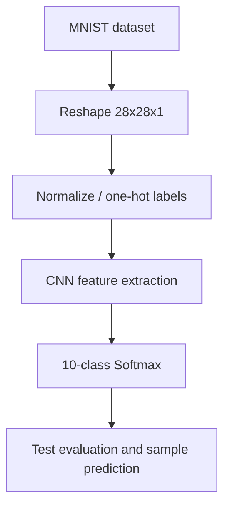

# Handwritten Digit Classification with CNN

**Project 033 · Domain:** Machine Learning · **Path:** `Machine_Learning/Handwritten_digit_classification`

## Overview
A convolutional neural network trained on the MNIST handwritten-digit dataset to classify grayscale images into digits 0–9.

## Pipeline
1. Load MNIST train and test partitions through `keras.datasets.mnist`.
2. Reshape images to 28×28×1 and normalize pixel values to [0,1].
3. One-hot encode the ten target classes.
4. Train a Keras Sequential CNN: Conv2D(32) → MaxPool → Conv2D(64) → MaxPool → Conv2D(64) → Flatten → Dense(64) → Dense(10, softmax).
5. Compile with Adam, categorical cross-entropy and accuracy.
6. Train for five epochs with batch size 64, evaluate on the test set, plot training/validation accuracy and inspect a sample prediction.

## Architecture


## Files and technologies
- `train.ipynb` — complete experiment.
- Python, TensorFlow/Keras, NumPy, Matplotlib, MNIST.
- Dataset is loaded by Keras; no separate dataset file is required.

## Run
```bash
cd Machine_Learning/Handwritten_digit_classification
python -m venv .venv
# Activate and install tensorflow, keras, numpy, matplotlib, jupyter
jupyter lab
``
Run `train.ipynb` from top to bottom.

## Observed result
The saved notebook output reports test accuracy of approximately **99.04%** (test loss approximately 0.0301). This is a historical notebook result and has not been independently rerun during this documentation review.

## Limitations and improvements
The notebook does not persist a trained model or provide a standalone inference script. Add model saving, a reusable preprocessing/inference function, fixed random seeds, a confusion matrix and per-class accuracy. Document the TensorFlow/Keras version used to reproduce the result.
