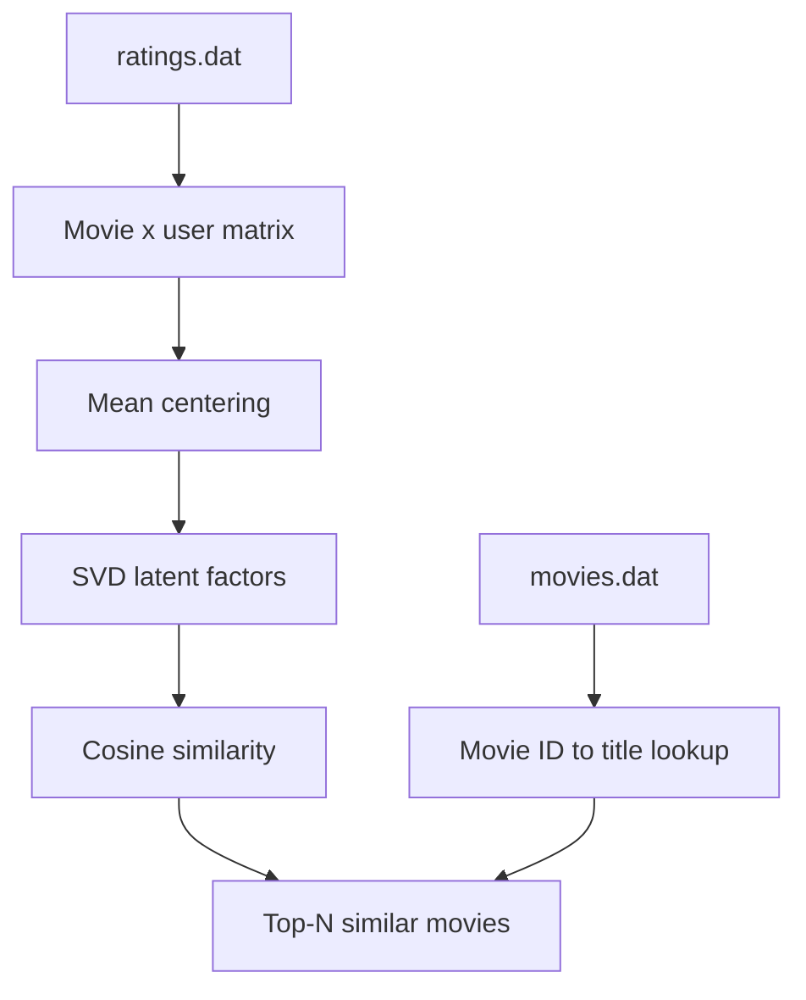

# Movie Recommendation System using Collaborative Filtering

**Project 034 · Domain:** Machine Learning · **Path:** `Machine_Learning/Recommentation_system`

## Overview
A notebook experiment that recommends movies using the MovieLens-style ratings and movie metadata files. It constructs a movie-by-user rating matrix, mean-centers rows, applies truncated Singular Value Decomposition (SVD), then ranks similar movie vectors using cosine similarity.

## Data
- `ratings.dat` — user ID, movie ID, rating and timestamp, parsed using `::` as delimiter.
- `movies.dat` — movie ID, title and genre, parsed using `::` and ISO-8859-1 encoding.
The ratings file is approximately 24.6 MB. The notebook uses a dense NumPy matrix sized by maximum movie and user IDs.

## Algorithm
1. Load ratings and movie metadata.
2. Populate a movie × user ratings matrix (missing ratings are initialized to zero).
3. Subtract each movie's mean rating.
4. Transpose/scale the matrix and compute SVD.
5. Retain the first 50 latent dimensions.
6. Compute cosine similarity for a selected movie ID and return the top 10 similar movie IDs/titles.

## Architecture


## Files and stack
- `train.ipynb` — recommendation workflow.
- `ratings.dat`, `movies.dat` — input data.
- Python, Pandas, NumPy, SVD (`numpy.linalg.svd`), cosine similarity.

## Run
```bash
cd Machine_Learning/Recommentation_system
python -m venv .venv
# Activate and install numpy pandas jupyter
jupyter lab
``
Run `train.ipynb` from top to bottom.

## Observed output
The notebook example queries movie ID 15 and prints ten nearest movie titles. The saved output includes a NumPy runtime warning for invalid division in cosine similarity.

## Limitations and improvements
The dense matrix can be memory-intensive. Zero-filled missing ratings and row-centering can bias similarity; zero-norm vectors cause divide-by-zero/NaN (the warning is present in saved output). Exclude the query item from recommendations, guard zero norms, use sparse matrices/TruncatedSVD, and evaluate with held-out interactions (Precision@K, Recall@K, MAP/NDCG). The current code is item-item similarity in latent space, not a personalized user-profile recommender. No fresh evaluation metrics are claimed.
