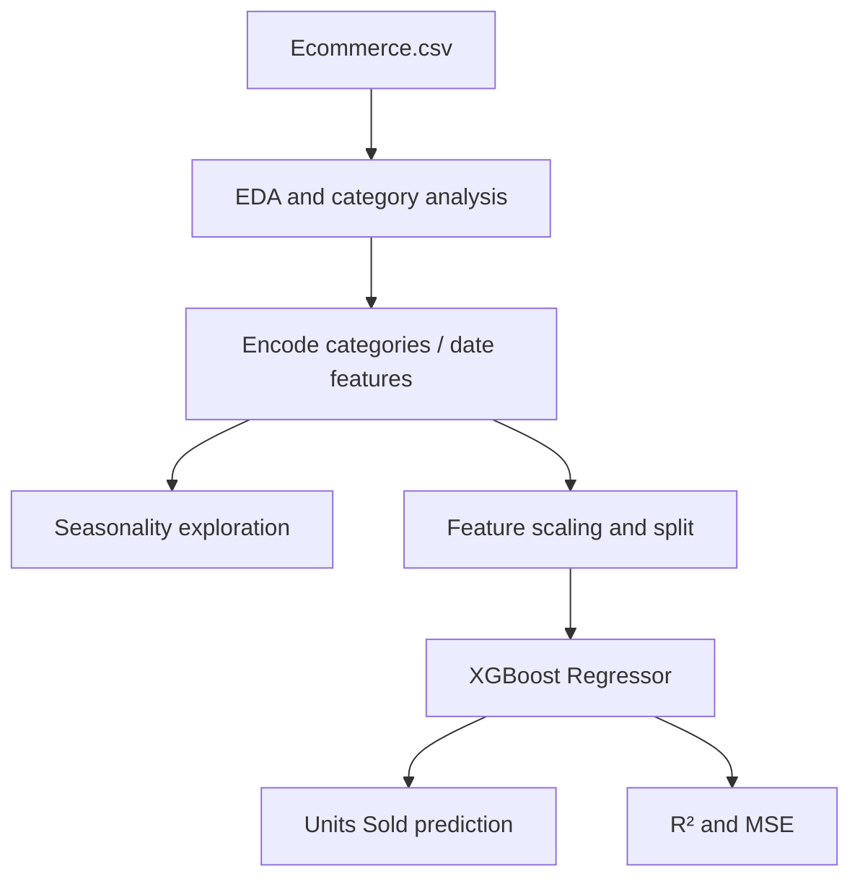

# E-commerce Sales Forecasting and Regression

**Project 035 · Machine Learning · `Machine_Learning/Sales_forecasting`**

## Purpose
Explore e-commerce sales data, visualize temporal and category patterns, and train an XGBoost regressor to estimate `Units_Sold`.

## Data and workflow
- Reads `Ecommerce.csv`; observed columns include date, product category, customer segment, discount and units sold.
- Encodes categorical columns with `LabelEncoder`, derives calendar features in notebook cells, and writes `modified.csv`.
- Performs category/segment summaries, plots, and additive seasonal decomposition with period 12.
- Scales predictors with `StandardScaler`; separates `Units_Sold` as target; uses an 80/20 random split (42).
- Fits `XGBRegressor`; reports R² and mean squared error.

## Architecture

## Files and stack
`train.ipynb`, `Ecommerce.csv`, generated `modified.csv`; Python, Pandas, NumPy, Matplotlib, Seaborn, Plotly, scikit-learn, statsmodels, XGBoost.

## Run
Create an environment with pandas, numpy, matplotlib, seaborn, plotly, scikit-learn, statsmodels, xgboost and jupyter; open `train.ipynb` and run in order from this directory.

## Saved notebook evidence and caveats
The stored output reports R² of approximately **-12.82** (printed as a percentage) and MSE approximately **61.02**. A negative R² means this fitted model performed worse than predicting the test-set mean on that split. The notebook has a feature engineering order issue: it drops `Date`, `Product_Category` and `Customer_Segment` before later cells reference them. The stored output may therefore reflect a partially executed or inconsistent run. Re-run from a clean kernel and correct the order before using results. No reliable model quality claim is made.

## Improvements
Use a chronological split for forecasting, avoid random leakage across time, fit encoders/scalers only on training data using a Pipeline, compare naive/seasonal baselines, inspect residuals, and report MAE/RMSE/R² with dates and target units.
