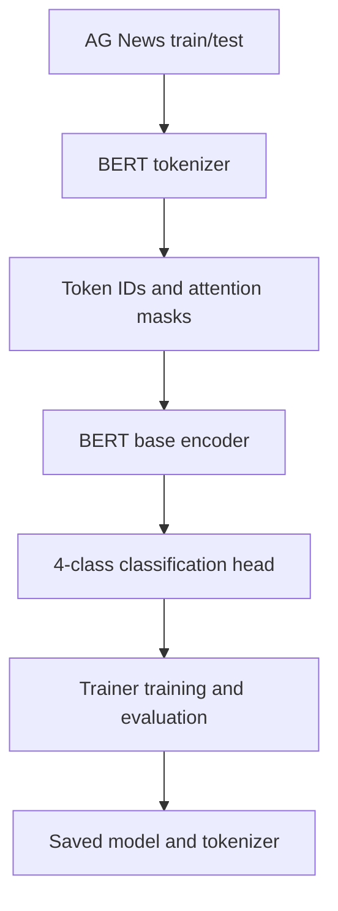

# AG News Topic Classification with BERT

**Project 036 · Machine Learning / NLP · `Machine_Learning/bert_text`**

## Purpose
Fine-tune the pretrained `bert-base-uncased` Transformer for four-class news-topic classification using the AG News dataset from Hugging Face Datasets.

## Pipeline
1. Download/load AG News with `datasets.load_dataset("ag_news")`.
2. Load the BERT tokenizer and tokenize the `text` field with truncation, padding and maximum sequence length 128.
3. Load `AutoModelForSequenceClassification` with four output labels.
4. Configure Hugging Face `Trainer`: learning rate 2e-5, weight decay 0.01, 3 epochs, train batch size 64, evaluation batch size 32 and FP16 requested.
5. Train, evaluate, then save model and tokenizer to `./bert-ag-news`.

## Architecture

## Files and stack
`text_classify_bert.ipynb`; Python, PyTorch, Transformers, Hugging Face Datasets, tokenizer/model hub assets.

## Run
Install compatible versions of `torch`, `transformers`, `datasets`, `accelerate` and `jupyter`; ensure internet access for dataset/model downloads; run the notebook top to bottom. FP16 requires supported accelerator hardware.

## Verification and limitations
The notebook contains training/evaluation calls and saves the model, but no concise numerical evaluation result was confirmed in the inspected output. The classifier head is newly initialized before fine-tuning, as expected. The notebook requests FP16 and sets `no_cuda=False`; this can fail on unsupported hardware. It uses the test split as Trainer's evaluation dataset, so a separate validation split is preferable for tuning and a held-out test split for final reporting. The `tokenizer` Trainer argument emits a deprecation warning in the captured environment.

## Improvements
Add explicit label names, validation split, accuracy/F1 metrics, pinned dependency versions, inference example, model-card metadata and CPU/GPU setup guidance.
