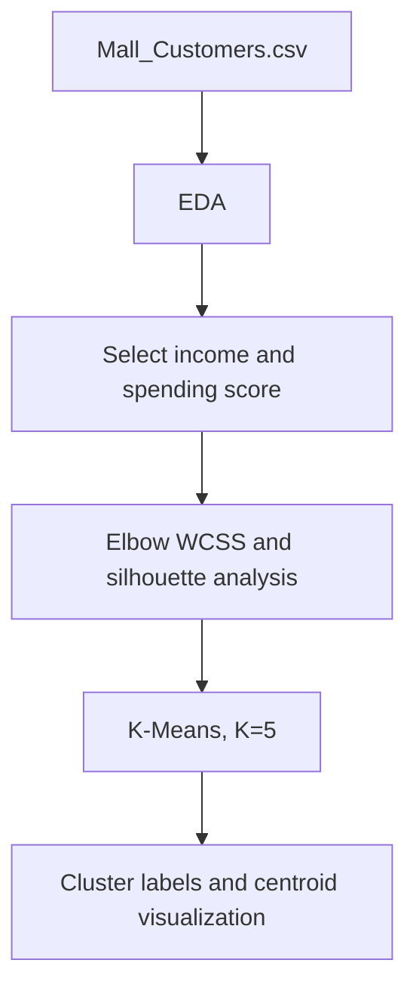

# Mall Customer Segmentation with K-Means

**Project 037 · Machine Learning · `Machine_Learning/customersegmentation`**

## Purpose and data
Unsupervised segmentation of mall customers using `Mall_Customers.csv`. The notebook selects the two features at columns 3–4 (Annual Income and Spending Score in the standard dataset) and explores customer groups.

## Method
- Inspect shape, summary statistics, types and missing values.
- Select annual income and spending score features.
- Compute within-cluster sum of squares (WCSS) for K=1..10 and silhouette scores for K=2..10.
- Fit `KMeans(n_clusters=5, init="k-means++", random_state=0)`.
- Plot the five clusters and their centroids.

## Architecture

## Files and stack
`k_means.ipynb`, `Mall_Customers.csv`; Python, Pandas, Matplotlib, scikit-learn.

## Run
Install pandas, matplotlib, scikit-learn and jupyter; open and execute `k_means.ipynb` from this folder.

## Important implementation note
The notebook creates `X_alter` with `StandardScaler`, but the WCSS, silhouette analysis and final K-Means calls use the original unscaled `X`. This is not equivalent to clustering the scaled features and can change distance-based grouping. The final choice K=5 is hard-coded; document the actual elbow/silhouette evidence before asserting it is optimal. No business interpretation or cluster profiles are persisted.

## Improvements
Use the same chosen feature matrix consistently, add random-state and `n_init` settings, profile each cluster (means/medians and sizes), test stability, and save a reusable fitted pipeline plus segment assignment output.
