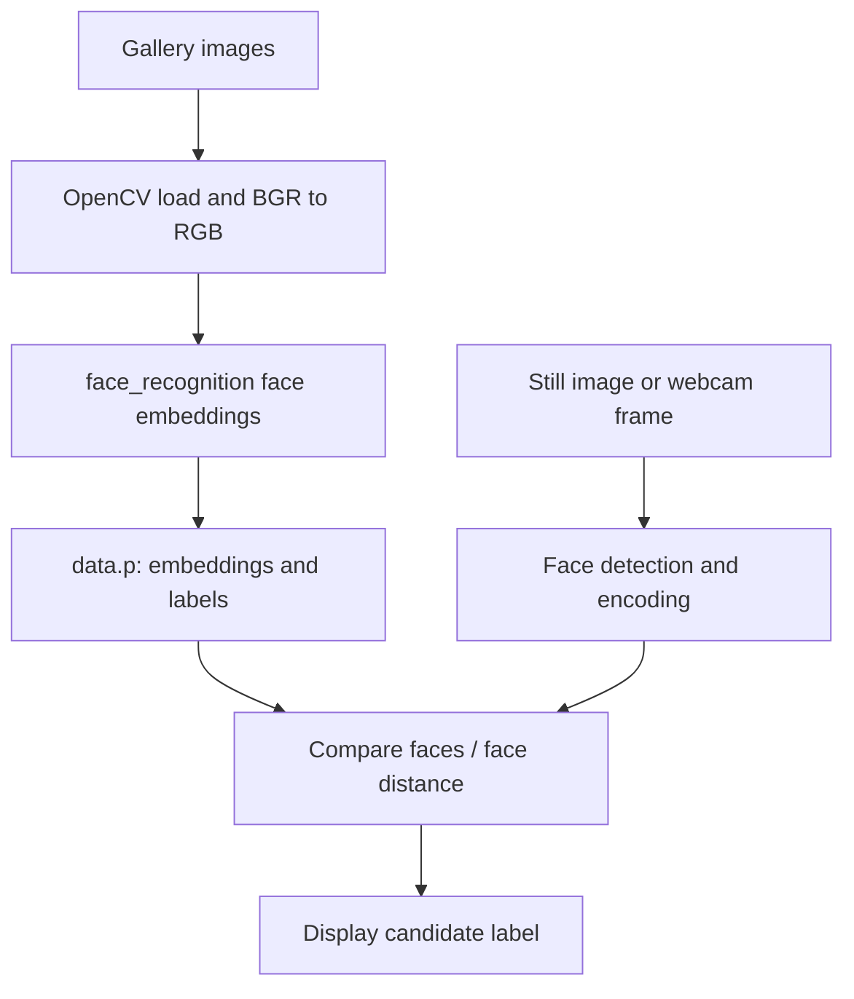

# Face Recognition: Image Encoding and Webcam Matching

**Project 038 · Machine Learning / Computer Vision · `Machine_Learning/facial_recognition`**

## Purpose
A local face-identification prototype that encodes faces from an `images/` gallery, serializes embeddings and labels, and compares still-image or webcam face encodings against that gallery.

## Components
- `en.py`: reads image files from `images/`, converts BGR to RGB, extracts a face encoding per image and pickles `[encodings, labels]` to `data.p`.
- `face_pro.py`: loads the pickle, reads a configured sample image, detects faces and compares encodings.
- `real_time.py`: opens webcam index 0, detects faces per frame, compares encodings and overlays a matching label.

## Architecture


## Stack and run
Python, OpenCV, `face_recognition` (dlib-based), NumPy, pickle. Install compatible OpenCV, face_recognition/dlib, NumPy and run from this directory:
```bash
python en.py
python real_time.py
``
The still-image example is `face_pro.py`. Webcam access is required for real-time mode.

## Limitations and safety
The gallery-building script assumes every file loads and contains a detectable face; it indexes the first encoding without handling zero/multiple faces. The still-image script uses a hard-coded image path and checks the truthiness of the matches list rather than whether any match is true. The real-time script selects the minimum-distance candidate but should apply an explicit distance threshold before assigning an identity; otherwise an unknown person may be labeled as the nearest known person. Pickle files must only be loaded from trusted sources.

Face embeddings and labels are biometric personal data. Obtain informed consent, restrict access, define retention/deletion rules, and do not use this prototype for consequential decisions or surveillance. No recognition accuracy or false-match rate is established.

## Improvements
Add face-count/error handling, distance threshold calibration on a consented validation set, unknown-person handling, secure embedding storage, documented gallery enrollment/deletion, tests and pinned system dependencies.
