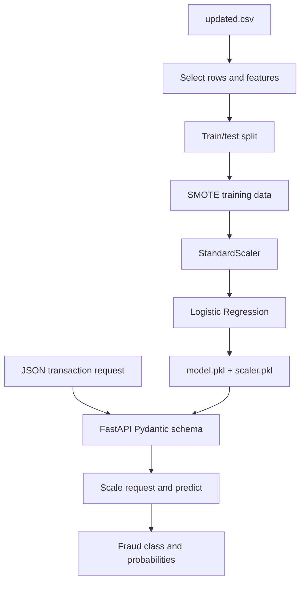

# Transaction Fraud Detection API

**Project 039 · Machine Learning · `Machine_Learning/frauddetection`**

## Purpose
A binary transaction-fraud classification experiment with a FastAPI inference endpoint. The training/demo script uses logistic regression, class rebalancing with SMOTE and standardization; the API loads the persisted estimator and scaler.

## Training workflow
- Read `updated.csv`, drop `Unnamed: 5` and `isFlaggedFraud`.
- Select the first 5,000 rows for the experiment; use the final column as target.
- Split train/test (80/20, random state 42).
- Apply SMOTE to the training partition only.
- Fit `StandardScaler` on resampled training features and transform test features.
- Train `LogisticRegression`; report accuracy and classification report.
- Save `model.pkl` and `scaler.pkl`.

## Serving workflow
`main.py` loads both artifacts and exposes:
- `GET /` — service welcome message.
- `POST /predict/` — accepts transaction amount, origin/destination balances and one-hot transaction type fields; returns predicted fraud class and probability vector.

## Architecture


## Run
Install fastapi, uvicorn, pydantic, pandas, numpy, scikit-learn, imbalanced-learn and matplotlib. From this directory:
```bash
python demo.py
uvicorn main:app --reload
``
Open `/docs` for the Swagger interface. The training script must be run before the API if the artifacts are absent or regenerated.

## Observed evidence and caveats
The notebook/script output is not treated as an independently validated benchmark. Training is restricted to the first 5,000 rows, and the API feature schema/order must exactly match the model's training columns. Confirm that `updated.csv` contains those features in the expected order. API currently returns class probabilities without named class mapping or a calibrated risk threshold.

## Improvements
Persist a single sklearn Pipeline, validate feature names/order and ranges, use time-aware or stratified evaluation as appropriate, report PR-AUC/recall/precision and confusion matrix, tune threshold for business costs, add request tests and input validation, and document model/data provenance. Fraud predictions are decision support, not proof of wrongdoing.
