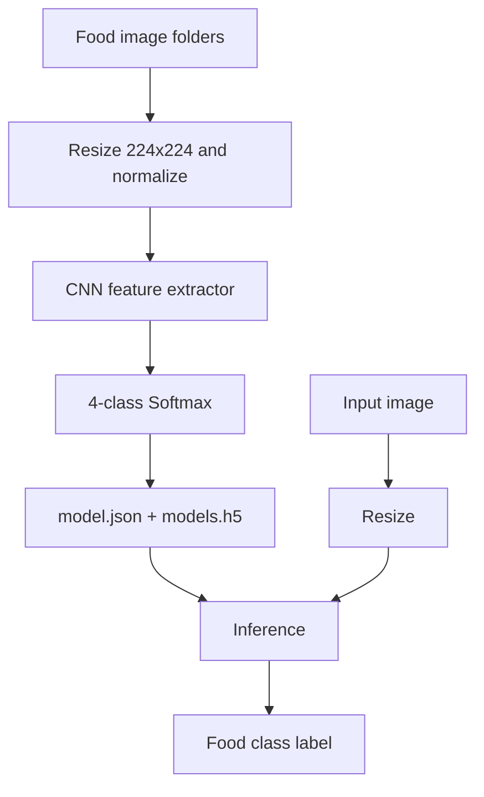

# Food Image Classification (Four Classes)

**Project 040 · Machine Learning / Image Classification · `Machine_Learning/image_classification_with_multilabel`**

## Purpose
Despite the folder name, the inspected notebook builds a four-class single-label image classifier for burgers, cookies, donuts and french fries. The output layer is a four-unit softmax and training uses categorical cross-entropy, not a multi-label sigmoid formulation.

## Workflow
- Load images from `dataset/Train` using Keras `ImageDataGenerator`, target size 224×224 and rescaling by 1/255.
- Train a Sequential CNN with Conv2D(64), pooling, batch normalization, Conv2D(128), pooling, batch normalization, flattening, Dense(128) and four-class softmax.
- Compile with Adam and categorical cross-entropy; train for 10 epochs.
- Save architecture to `model.json` and weights to `models.h5`.
- `test.py` loads architecture/weights, resizes a supplied image and prints the predicted class.

## Architecture


## Files and stack
`train.ipynb`, `test.py`, `dataset/`, `model.json`, `models.h5`; Python, TensorFlow/Keras, NumPy, Pillow, Matplotlib.

## Run
Install compatible tensorflow/keras, numpy, pillow and jupyter; run notebook from this directory. For inference:
```bash
python test.py
``
The example image path is hard-coded in `test.py`.

## Captured evidence and limitations
The notebook output reports 163 images across four classes and a 10-epoch training run. The test script does not normalize pixel values although training does, causing a preprocessing mismatch. It also assumes RGB image mode and hard-codes class order, which must match `flow_from_directory`'s class-index order. The project is multiclass classification, not multi-label classification.

## Improvements
Persist class-index mapping and preprocessing configuration, normalize inference images identically, handle RGB conversion and missing files, add validation split, per-class metrics and confusion matrix, and rename the project or explicitly explain the single-label task.
