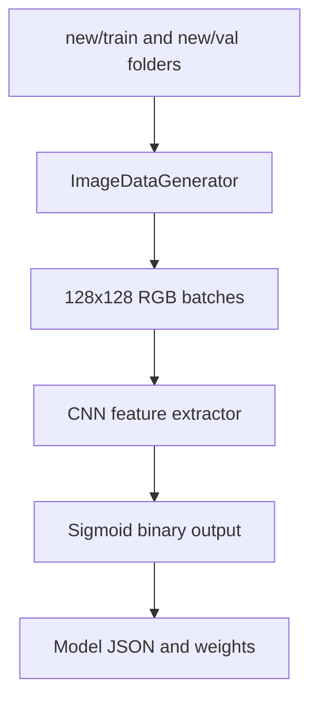

# Binary Image Classification with CNN

**Project 041 · Machine Learning · `Machine_Learning/image_classify`**

## Purpose
A binary image-classification experiment using a Keras CNN and directory-based image generators. The notebook trains on images under `new/train` and validates using `new/val`.

## Model and data pipeline
- Input shape: 128×128×3.
- CNN: Conv2D(64) → MaxPool → Dropout(0.2) → Conv2D(96) → MaxPool → Dropout(0.2) → Conv2D(96) → MaxPool → Dropout(0.3) → Flatten → Dense(128) → Dense(1, sigmoid).
- Compile with Adam, binary cross-entropy and accuracy.
- Training generator applies shear, zoom and horizontal flip; validation generator rescales by 1/255.
- Uses `EarlyStopping` configuration with validation loss and restore-best-weights, though the callback is defined but not passed to `model.fit` in the inspected cell.
- Exports architecture to `model.json` and weights to `weights.h5`.

## Architecture

## Files and stack
`train.ipynb`; expected data folders `new/train` and `new/val`; Python, Keras/TensorFlow, NumPy, Matplotlib.

## Run
Install compatible tensorflow/keras, numpy, matplotlib and jupyter. Ensure both directory trees contain the same two class subfolders; execute notebook cells in order.

## Limitations
The checked-in directory listing contains the notebook but does not show the expected `new/train` and `new/val` assets. The training generator uses `rescale=None` while validation uses 1/255, producing inconsistent input scales. The callback variable is defined but omitted from the `fit` call. No inference script or captured reliable metrics were confirmed.

## Improvements
Make preprocessing identical for train and validation, pass callbacks to fit, persist class indices, add a holdout evaluation and inference utility, and document the two class names and dataset source.
