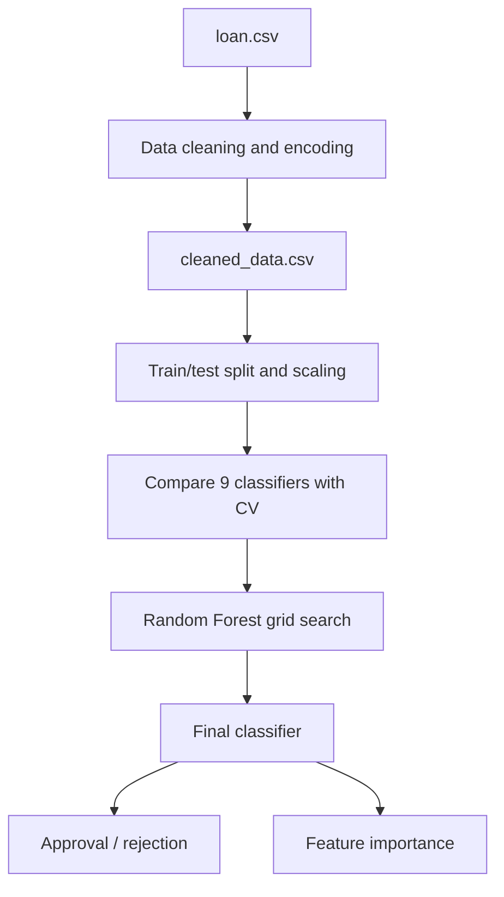

# Loan Approval Prediction and Model Comparison

**Project 042 · Machine Learning · `Machine_Learning/loan_prediction`**

## Purpose
A tabular binary classification experiment predicting loan approval status from applicant, income, loan and asset attributes.

## Data and preprocessing
The notebook reads `loan.csv` (4,269 rows and 13 columns in captured output), removes `loan_id`, handles education via one-hot encoding, maps employment and loan status strings to numeric values, and writes `cleaned_data.csv`. It scales features using `StandardScaler`.

## Model experiments
The notebook compares Logistic Regression, Linear Discriminant Analysis, KNN, Decision Tree, Gaussian Naive Bayes, SVM, XGBoost, AdaBoost and Random Forest with five-fold StratifiedKFold cross-validation. It then runs GridSearchCV for Random Forest over estimator count, criterion and max depth, trains a selected Random Forest and prints accuracy and feature importance. A console-input helper builds a one-row applicant record for prediction.

## Architecture

## Stack and run
Python, Pandas, NumPy, Matplotlib, Seaborn, Plotly, scikit-learn, XGBoost. Install compatible dependencies and Jupyter, then run `train.ipynb` from this folder.

## Captured results and caveats
Captured cross-validation means include XGBoost around 0.9818 and Random Forest around 0.9780; a later selected Random Forest output reports approximately 97.78% accuracy. These are saved notebook outputs, not fresh validation. The notebook also records 120 failed fits out of 360 during tuning, which must be investigated. The train/test split uses `random_state=None`, reducing reproducibility. Some code has inconsistent feature/encoder handling risk between training and interactive prediction; ensure the exact training column order is recreated. The scaler is not persisted with the model.

## Improvements
Use a Pipeline/ColumnTransformer, fixed stratified split, robust CV, investigate failed fits, persist preprocessing and model together, calibrate probabilities, report confusion matrix/precision/recall/ROC-AUC and fairness checks. Loan predictions are decision support and require human review.
