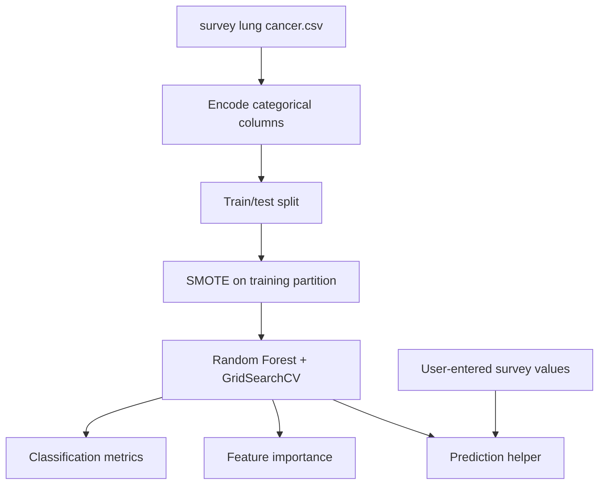

# Lung Cancer Risk Classification Experiment

**Project 043 · Machine Learning · `Machine_Learning/predictive_analysis_health_care`**

## Purpose
A supervised classification notebook that uses a lung-cancer survey dataset to estimate the dataset's `LUNG_CANCER` label from demographic and symptom/risk-factor fields. This is an educational ML experiment, not a clinical diagnostic tool.

## Data and workflow
- Downloads a Kaggle dataset using `kagglehub`; the notebook then reads the checked-in `survey lung cancer.csv`.
- Encodes `GENDER` and `LUNG_CANCER` using LabelEncoder.
- Splits features/target into train/test partitions (80/20, random state 42).
- Applies SMOTE to the training data.
- Uses RandomForestClassifier with a grid search over `n_estimators`, `max_depth` and `min_samples_split`.
- Reports best parameters/score, test accuracy and classification report; plots feature importance and includes a console-input prediction helper.

## Architecture

## Files and stack
`train.ipynb`, `survey lung cancer.csv`, `dataseter.csv`, archive assets; Python, Pandas, NumPy, Matplotlib, Seaborn, scikit-learn, imbalanced-learn, KaggleHub, category_encoders import.

## Run
Install the notebook dependencies including pandas, numpy, scikit-learn, imbalanced-learn, matplotlib, seaborn, kagglehub and jupyter. Run from this directory. The checked-in CSV is read by the modeling cells; KaggleHub download cell is a separate data acquisition step and requires network access.

## Limitations and responsible use
No validated clinical performance is established. Dataset size in captured output is 309 records, which is small for medical risk modeling. The notebook uses a single LabelEncoder instance sequentially for two columns; use explicit mappings for stable category semantics. SMOTE and model selection must be confined to each training fold (use an imbalanced-learn Pipeline during CV) to avoid validation leakage. Dataset provenance, representativeness, missingness, calibration and external validation are not documented.

## Improvements
Document source/license and feature definitions, use nested stratified validation with preprocessing inside folds, report sensitivity/specificity/PR-AUC and calibration, evaluate subgroup performance, and clearly state that output cannot diagnose or rule out cancer. Do not use for patient care.
