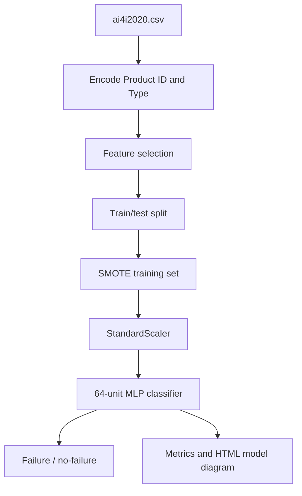

# Predictive Maintenance / Machine Failure Classification

**Project 044 · Machine Learning · `Machine_Learning/predictive_maintenance_system`**

## Purpose and dataset
A binary classification experiment using the AI4I 2020 predictive-maintenance dataset (`ai4i2020.csv`, 10,000 rows in captured notebook output) to estimate the `Machine failure` target from machine operating conditions and failure-mode indicators.

## Pipeline
- Read dataset and inspect data.
- Frequency-encode `Product ID`; LabelEncode `Type`; remove identifiers and original categorical columns from the feature matrix.
- Split train/test (80/20; random state is not fixed).
- Apply SMOTE to training data, then standardize features.
- Train an `MLPClassifier` with one 64-unit hidden layer, ReLU and Adam.
- Report accuracy and classification report.
- Build a console input helper and export an HTML representation of the MLP to `mlp_structure.html`.

## Architecture

## Files and stack
`train.ipynb`, `ai4i2020.csv`, `mlp_structure.html`; Python, Pandas, NumPy, scikit-learn, imbalanced-learn, Matplotlib.

## Run
Install pandas, numpy, scikit-learn, imbalanced-learn, matplotlib and jupyter; run `train.ipynb` from this directory. The HTML file is generated by the notebook.

## Implementation cautions
The notebook computes frequency encoding for Product ID, but inference asks the user to enter an encoded ID manually. The training split is not seeded. The scaler and model are not serialized for a standalone inference program. Captured output contains feature-name warnings because the model/scaler are fitted on arrays but prediction is made with a DataFrame. No independently reproduced performance metric is asserted.

## Improvements
Persist the encoder/scaler/model as a single Pipeline, make train/test split reproducible and stratified, avoid SMOTE leakage by placing it inside CV folds, evaluate recall/precision and PR-AUC for rare failures, define a realistic inference schema, and compare against tree-based baselines. Maintenance alerts should be validated with domain experts before operational use.
