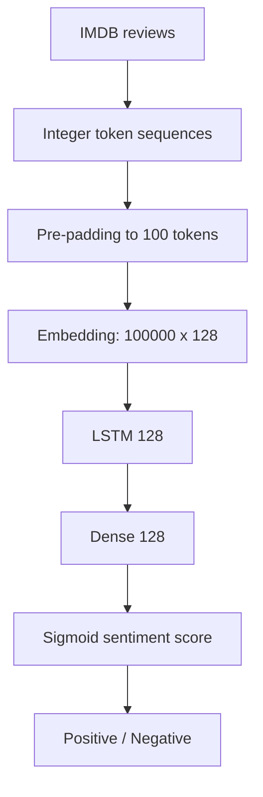

# Movie Review Sentiment Analysis with LSTM

**Project 045 · Machine Learning / NLP · `Machine_Learning/sentiment_Analysis`**

## Purpose
A binary sentiment classifier trained on the IMDB movie-review dataset using an embedding layer and LSTM recurrent network.

## Workflow
- Load IMDB train/test splits from Keras.
- Configure vocabulary limit 100,000 and sequence length 100.
- Pre-pad sequences to a common length.
- Build Sequential model: Embedding(100, 128) → LSTM(128, ReLU) → Dense(128, ReLU) → Dense(1, sigmoid).
- Compile with Adam, binary cross-entropy and accuracy.
- Train for up to 10 epochs, batch size 64, 20% validation split, EarlyStopping and ModelCheckpoint.
- Evaluate on the test set, plot loss/accuracy curves and run a sample review prediction.
- Save best checkpoint to `model.h5`.

## Architecture

## Files and stack
`train.ipynb`, `model.h5`; Python, TensorFlow/Keras, IMDB dataset, Matplotlib.

## Run
Install compatible tensorflow/keras, matplotlib and jupyter; run the notebook from this directory. Keras downloads the IMDB dataset if it is not cached.

## Captured output and critical issue
The saved output reports test accuracy around **69.22%**, but the printed test loss is extremely large (approximately 4,136,658.75). The training output also shows an unusually large first-epoch loss. This suggests numerical instability or an implementation problem; accuracy alone should not be treated as evidence of a reliable model. The notebook uses an LSTM with ReLU, which is atypical for recurrent gating, and its prediction example creates a new Tokenizer rather than reusing a tokenizer fitted on training data. This makes the sample inference path invalid/inconsistent.

## Improvements
Use the original IMDB word-index mapping or persist a fitted tokenizer, prefer the standard LSTM activation defaults, verify label/sequence preprocessing, inspect loss curves, add PR/F1 and confusion matrix, compare a simple baseline, and save model plus tokenizer/preprocessing metadata together. Do not claim production-ready sentiment quality from the stored run.
