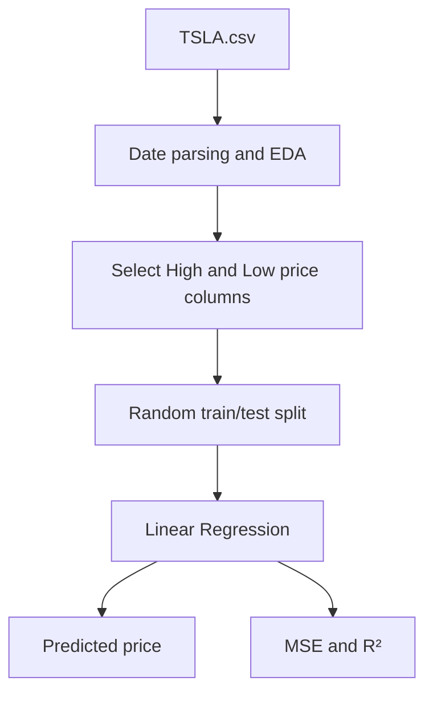

# Tesla Stock Price Regression Experiment

**Project 046 · Machine Learning · `Machine_Learning/stock_price`**

## Purpose and data
A notebook experiment using historical Tesla stock data from `TSLA.csv` (2,416 rows in captured output, dated 2010-06-29 through 2020-02-03) to explore price relationships and fit a Linear Regression model.

## Method
- Parse `Date` and set it as the index.
- Inspect descriptive statistics and plot historical High prices.
- Use the second and third columns as predictors/target (the notebook plots and labels them High and Low).
- Random 80/20 train/test split with random state 42.
- Fit `LinearRegression`; compute MSE and R²; plot actual versus predicted values.

## Architecture

## Files and stack
`train.ipynb`, `TSLA.csv`; Python, Pandas, NumPy, Matplotlib, scikit-learn.

## Run
Install pandas, numpy, matplotlib, scikit-learn and jupyter; execute `train.ipynb` from this directory.

## Interpretation and limitations
This is a simple contemporaneous price regression experiment, not a validated future stock forecasting system. A random split ignores time ordering and may overstate generalization for time-dependent data. The notebook imports StandardScaler, Lasso and Ridge but the inspected model fit uses ordinary LinearRegression. No investment return or trading strategy is evaluated. Financial markets are noisy; model output is not investment advice.

## Improvements
Define a future prediction horizon, construct lagged/rolling features using past data only, use chronological train/validation/test partitions or walk-forward validation, compare naive baselines and regularized models, report MAE/RMSE/R², and prevent look-ahead leakage. Document adjusted-close/dividend/split handling and data source.
