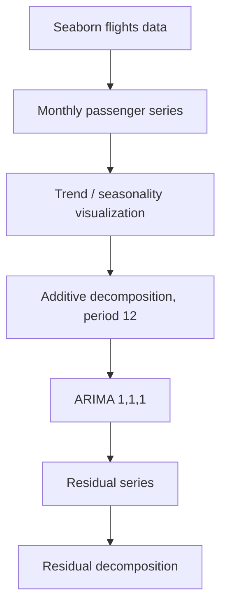

# Time Series Analysis and ARIMA on Airline Passengers

**Project 047 · Machine Learning / Time Series · `Machine_Learning/timeseries`**

## Purpose and data
An exploratory time-series notebook using Seaborn's built-in monthly airline passenger dataset (144 observations, 1949–1960). It visualizes seasonality and trend, decomposes the series, fits an ARIMA model and examines residuals.

## Workflow
1. Load Seaborn `flights` dataset.
2. Pivot monthly passenger counts by year and visualize trends and a heatmap.
3. Aggregate to monthly observations and construct a date index.
4. Apply additive seasonal decomposition with period 12.
5. Fit `ARIMA(1,1,1)` using statsmodels.
6. Decompose model residuals for diagnostic exploration.

## Architecture

## Files and stack
`train.ipynb`; Python, Pandas, NumPy, Seaborn, Matplotlib, Plotly, statsmodels.

## Run
Install pandas, numpy, seaborn, matplotlib, plotly, statsmodels and jupyter; open `train.ipynb` and execute from top to bottom.

## Limitations
The notebook is primarily exploratory. The inspected cells do not establish a held-out forecast evaluation, compare against seasonal-naive baselines, or report forecast errors. The date index frequency is inferred by statsmodels in the captured warning. Residual decomposition alone is not sufficient to establish model adequacy.

## Improvements
Set an explicit monthly frequency, inspect ACF/PACF and stationarity, compare seasonal ARIMA/ETS and naive baselines, use rolling-origin validation, report MAE/RMSE/MAPE, and plot prediction intervals against a held-out period.
