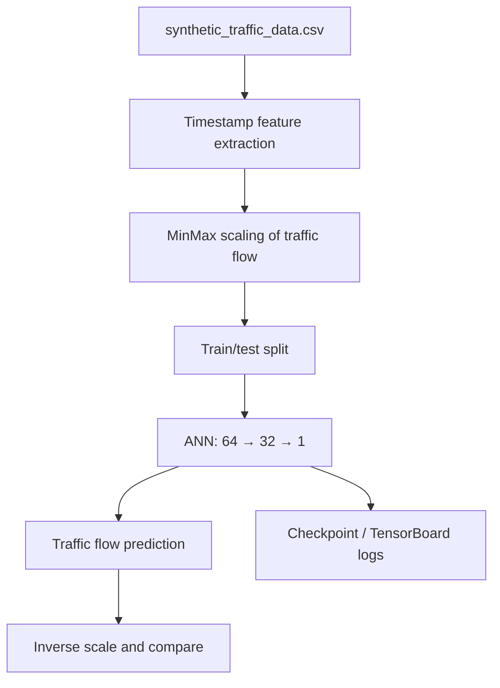

# Traffic Flow Prediction with Artificial Neural Network

**Project 048 · Machine Learning / Time Series · `Machine_Learning/traffic_prediction`**

## Purpose and data
A regression notebook that trains a feed-forward Keras neural network to estimate scaled traffic flow using time-derived features from `synthetic_traffic_data.csv`. The folder also contains `Traffic.csv`, but the inspected notebook reads the synthetic dataset.

## Pipeline
- Load the synthetic traffic dataset.
- Derive hour, day and year from the timestamp.
- Scale `traffic_flow` with MinMaxScaler.
- Select two columns from the dataframe as input features and use scaled traffic flow as target.
- Random 80/20 split with random state 42.
- Train Dense(64, ReLU) → Dense(32, ReLU) → Dense(1) using RMSprop, MAE loss and MSE metric.
- Use ModelCheckpoint, EarlyStopping (patience 3) and TensorBoard.
- Inverse-transform predictions and plot actual versus predicted flow.

## Architecture

## Files and stack
`train.ipynb`, `synthetic_traffic_data.csv`, `Traffic.csv`, `model.h5`, `logs/`; Python, Pandas, NumPy, Matplotlib, Seaborn, TensorFlow/Keras, scikit-learn.

## Run
Install compatible pandas, numpy, tensorflow/keras, scikit-learn, matplotlib, seaborn and jupyter; run notebook from this directory. TensorBoard logs are written under `logs`.

## Limitations and improvements
The notebook's feature selection uses positional slicing (`data.iloc[:,2:4]`) after adding derived columns; confirm that the selected columns are the intended predictors (the source dataset has location/day/hour fields). A random split may leak adjacent time observations and does not test future-period generalization. The dataset is explicitly synthetic, so results do not establish real-world traffic performance. The notebook rescales the target but does not persist the scaler for inference. The captured run includes training/validation loss output but no final independent metric is asserted.

Use chronological splits, add lagged traffic and calendar/location features with explicit column names, compare seasonal/naive baselines, persist model and scaler, evaluate MAE/RMSE on future periods, and document dataset generation assumptions before real deployment.
