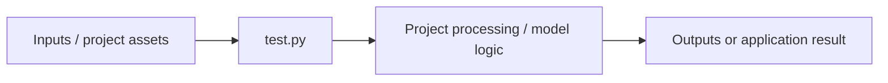

# Ocr

**Project 053** · **Domain:** computer vision

## 1. Project Overview

This project addresses **optical character recognition**. This description is derived from the checked-in filenames, imports, symbols, and notebook/source signals; behavior not evidenced by those files is not claimed.

## 2. Problem Statement

The implementation explores a technical workflow related to optical character recognition. The repository does not specify a formal business problem statement beyond the available implementation artifacts.

## 3. Objectives

- Implement or demonstrate the workflow represented by the source files in this directory.
- Use the checked-in data, model artifacts, or configuration where referenced by the code.
- Provide an executable experiment or application entry point where one is present.

## 4. Technical Architecture



This is a static architecture view. Exact runtime wiring, external services, and deployment topology are **not verifiable from the available implementation** unless listed in the source files.

## 5. Technologies Used

| Language | Python |
| Libraries detected from imports | `cv2`, `pytesseract` |
| Dependency manifests | Not specified in the repository |

## 6. Project Structure

Important directly contained files:

- [`test.py`](<test.py>)

Nested assets/directories observed: No nested project assets detected.

Extracted implementation symbols and notebook headings:
- No function/class or notebook-heading summary was extractable statically.

## 7. Implementation Workflow

1. Start from `test.py`.
2. Load or receive the inputs referenced by the implementation and project assets.
3. Apply the preprocessing, model, or application logic present in the source.
4. Produce the outputs described by the code.

The repository does not provide a separately verified end-to-end run command or reproducible evaluation trace for this project unless noted below.

## 8. Core Features

Only the following evidence-backed features are documented: source/notebook execution represented by the entry points above; use of the detected libraries; and any processing implied by the checked-in code. A user-facing feature list, API contract, and production readiness are not specified in the repository.

## 9. Algorithms and Models

Detected technical signals: `cv2`, `ocr`. Model architectures, hyperparameters, and algorithm details should be read from the linked source/notebook files; no unverified accuracy claim is made here.

## 10. Installation and Setup

No dependency manifest is present for this project. Install only the dependencies explicitly imported by the source after reviewing the files. For Python-based files, create an isolated environment. Do not install from untrusted sources without reviewing the files first.

```bash
cd "computer vision/OCR"
python -m venv .venv
# Activate .venv, then install dependencies from a checked-in manifest if present.
```

## 11. Configuration

Configuration files and environment variables are not separately specified by the repository for this project. Review source references to API keys, paths, model files, and datasets before running. Never commit secrets.

## 12. Execution Instructions

The checked-in entry point candidates are: `test.py`. Use the command appropriate to the actual file, for example:

```bash
cd "computer vision/OCR"
python test.py
```

Notebook execution is not run as part of documentation generation. Use Jupyter locally after reviewing paths and dependencies.

## 13. Input and Output

Inputs and outputs are determined by the code and checked-in assets. Directly observed nested assets are summarized above. A stable command-line/API schema is **not specified in the repository** unless implemented by the entry point.

## 14. Results and Evaluation

No independently reproduced metrics are reported here. Any metrics or outputs shown in a notebook remain repository-provided artifacts and should be validated by rerunning the relevant cells in a controlled environment.

## 15. Use Cases

Potential applications include experimentation, learning, prototyping, and evaluation of the documented workflow for optical character recognition. Production use would require validation, tests, data governance, security review, and operational packaging.

## 16. Limitations

- Reproducibility may depend on local paths, large datasets, binary model files, or unavailable services.
- Automated documentation did not execute application code or notebooks.
- The repository does not consistently provide dependency locks, tests, deployment instructions, or measured evaluation results.
- Claims beyond the checked-in implementation are not verifiable.

## 17. Future Improvements

- Add a minimal reproducible setup with pinned dependencies and documented data acquisition.
- Add tests, deterministic evaluation, and explicit input/output contracts.
- Separate generated artifacts and datasets from source code where appropriate.
- Document security, privacy, deployment, and monitoring requirements for any production deployment.

## 18. Author

Rajkumar V.

GitHub: https://github.com/Rajkumar-Ai-Engineer
