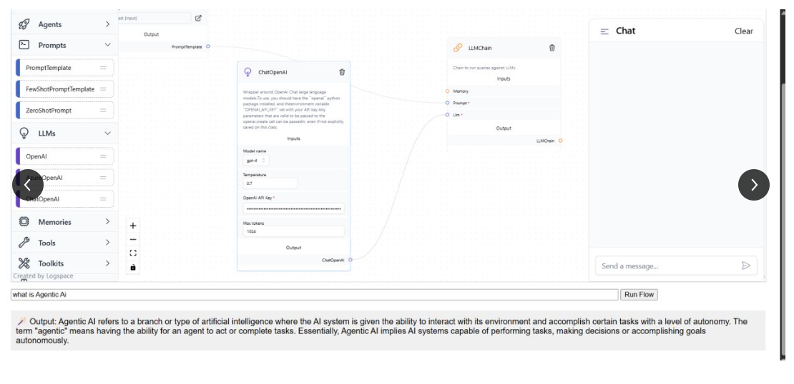
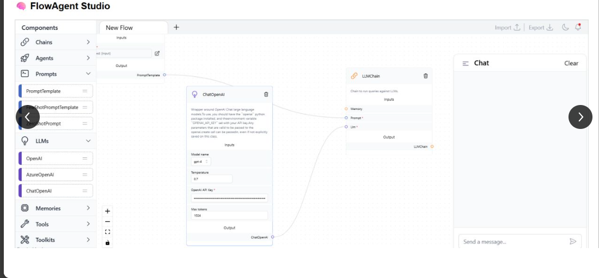
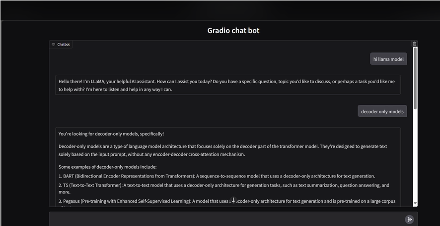

# Generative AI — Project 081 Reference Assets

This folder contains four PNG project-reference assets. Three filenames explicitly include the number 81; the fourth is unnumbered. They are reference images, not an executable project.

## Project 081 reference set

## Related unnumbered reference

## Verification status
- Four PNG files are present.
- No Python source, notebook, dependency manifest or executable application is present in this directory.
- Match the visual concept to source elsewhere before marking Project 081 implemented.
- Do not count the four images as four separate projects.
- See [GenerativeAI/README.md](../GenerativeAI/README.md) and the [master catalogue](../README.md).
